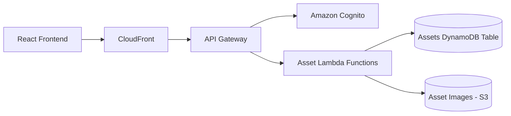

# Update Assets Module README Documentation

## Objective

Update the existing `README.md` documentation for the **Assets module** based on the actual implementation in this repository.

The current Assets module already uses these sections:

```markdown
- [Assets Module](#assets-module)
- [Overview](#overview)
- [Problem](#problem)
- [Solution](#solution)
- [User Experience](#user-experience)
- [Scope](#scope)
- [Architecture](#architecture)
- [Key Design Principles](#key-design-principles)
- [Data Model](#data-model)
- [Infrastructure](#infrastructure)
- [Prerequisites](#prerequisites)
- [Open Questions](#open-questions)
```

## Important

Keep this existing structure.

Do **not** replace it with a completely different README layout.

You may add suitable subsections under the existing headings where this improves clarity, especially under:

- Architecture
- Data Model
- Infrastructure
- Key Design Principles
- User Experience

Only update the Assets module section of the existing `README.md`.

---

# Critical Scope Restriction

Only modify:

```text
README.md
```

and only the content belonging to the **Assets module**.

Do NOT modify:

- Lambda source files
- Terraform
- API Gateway configuration
- DynamoDB definitions
- frontend code
- shared utilities
- YAML/OpenAPI files
- deployment scripts
- package files
- any other README section
- Asset Transfer module documentation
- Disposal module documentation

This task is documentation-only.

If implementation inconsistencies are discovered, document them under `Open Questions` where appropriate.

Do not fix them.

---

# Investigation Before Writing

Before updating the README, inspect the current Assets implementation in the repository.

Trace the complete asset flow through:

```text
Frontend
   ↓
CloudFront
   ↓
API Gateway
   ↓
Cognito Authorizer
   ↓
Asset Lambda Functions
   ↓
DynamoDB
   ↓
S3 / other supporting services
```

Inspect:

- Asset CRUD Lambda functions
- API Gateway routes
- DynamoDB asset table
- GSIs
- Cognito authorization
- user/location restrictions
- S3 image handling
- asset filtering
- asset verification if implemented
- asset condition/status handling
- integration with Jobs, Transfers and Disposals where relevant
- frontend Asset pages/forms only where necessary to understand behaviour

Do not assume behaviour based only on filenames.

Trace the actual implementation.

---

# Overview

Update the existing `Overview` section with a concise explanation of the Assets module.

Describe it as the central asset register and asset lifecycle component of the application.

Where supported by the implementation, explain that it manages:

- asset records
- asset identification
- location
- area
- equipment/category
- condition/status
- images
- verification
- maintenance relationships
- transfers
- disposals

Keep this section high level.

Do not duplicate infrastructure details here.

---

# Problem

Preserve the existing intent of the `Problem` section.

Improve it where necessary to explain the operational issues the Assets module addresses.

Potential issues may include:

- fragmented asset registers
- inaccurate location data
- poor visibility of equipment condition
- difficulty tracing individual assets
- inconsistent asset identification
- lack of verification history
- difficulty linking maintenance activity to assets
- asset movement between branches
- asset disposal tracking

Only include requirements supported by the current application or existing documentation.

Do not invent business requirements.

---

# Solution

Update the `Solution` section to explain how the module provides a central asset-management capability.

Describe functional capabilities such as:

```text
Asset created
      ↓
Stored in central asset register
      ↓
Assigned to location / area / equipment
      ↓
Viewed / updated / verified
      ↓
Linked to maintenance activity where applicable
      ↓
Transferred or disposed where applicable
```

Use actual implemented behaviour.

Where useful, add subsections such as:

```markdown
### Asset Registration

### Asset Updates

### Asset Verification

### Asset Images

### Maintenance Integration

### Transfers and Disposals
```

Only add subsections that correspond to actual functionality.

---

# User Experience

Document the Assets module from the user's perspective.

Inspect the current frontend and authorization behaviour.

Describe functionality such as:

- viewing the asset list
- filtering assets
- opening asset details
- creating assets
- editing assets
- viewing asset images
- verifying assets
- viewing condition/status
- identifying location/area/equipment
- navigating to related maintenance information
- initiating or viewing transfers where integrated
- disposal relationships where integrated

Document which roles can perform which actions where the implementation defines this.

Possible roles may include:

```text
admin
technician
manager
user
contractor
```

Only document actual Assets permissions.

Do not copy the Jobs permission model unless the Assets implementation uses the same logic.

---

# Scope

Clearly define what belongs to the Assets module.

Include relevant responsibilities such as:

- asset master data
- asset CRUD
- asset images
- asset location
- area/equipment classification
- condition/status
- asset verification
- asset search/filtering
- maintenance relationships
- transfer/disposal references where directly integrated

Explicitly distinguish Assets from related modules.

For example:

```text
Assets
→ owns the central asset record.

Transfers
→ manages movement of existing assets.

Disposals
→ manages disposal workflows for existing assets.

Jobs
→ manages maintenance work associated with assets.
```

Verify these boundaries against the implementation before documenting them.

---

# Architecture

Use this section as the main technical overview of the Assets module.

Add appropriate subsections such as:

```markdown
### Request Flow

### Asset Lifecycle

### Authentication and Authorization

### Image Flow

### Module Integrations
```

if useful.

---

# Request Flow

Document the actual request path.

For example:

```text
React Frontend
      ↓
CloudFront
      ↓
API Gateway
      ↓
Cognito
      ↓
Asset Lambda
      ↓
DynamoDB
```

Where applicable:

```text
Asset Lambda
   ├── DynamoDB
   ├── S3
   └── other supporting AWS services
```

Only include services that actually participate in the Assets module.

---

# Simple Architecture Diagram

Add a simple Mermaid diagram under `Architecture`.

Keep it simple because I will refine the final architecture diagram separately.

Example only:



Do not blindly use this exact diagram.

Update it based on the real implementation.

If verification, maintenance, transfers or disposals have important architectural relationships, represent them simply without making the diagram overly complex.

---

# Authentication and Authorization

Inspect how Assets API routes are protected.

Document:

- Cognito authorizer
- claims used by Lambda functions
- Cognito groups
- user `sub`
- location-based access
- admin/technician privileges
- other role restrictions

Only document actual authorization logic.

Do not infer permissions from frontend visibility alone.

Where Lambda functions enforce permissions, document those rules.

---

# Key Design Principles

Update this section based on the actual implementation.

Possible principles may include:

## Central Asset Register

A single DynamoDB table represents the authoritative asset record.

Verify this before documenting it.

## Stable Asset Identification

Explain how assets are identified.

Inspect fields such as:

```text
id
assetID
```

Determine which represents the DynamoDB primary key and which represents the business asset identifier.

## Location-Based Organisation

Explain how assets are associated with:

```text
location
area
equipment
```

and how these values are used for filtering or workflow decisions.

## Serverless Architecture

If applicable, explain that Assets uses:

```text
API Gateway
Lambda
DynamoDB
S3
Cognito
```

without dedicated application servers.

## Least-Privilege Access

Where IAM and Cognito enforce this, describe the principle at a high level.

## Presigned S3 Access

If asset images use presigned URLs, explain why the application does not expose the S3 bucket directly.

## Integration Without Data Duplication

Where Transfers, Jobs and Disposals reference the central asset record rather than duplicating it, document this principle.

Only include principles actually reflected in the implementation.

---

# Data Model

This should be one of the more detailed sections.

Inspect actual DynamoDB reads/writes and document the current asset object.

Do not construct the schema from assumptions.

Potential fields may include:

```text
id
assetID
location
area
equipment
condition
images
createdAt
updatedAt
verificationDate
verificationStatus
```

These are examples only.

Use actual names.

Group fields logically where useful:

```markdown
### Identity

### Classification

### Location

### Condition

### Images

### Verification

### Lifecycle References
```

---

# Primary Key and Indexes

Document the actual DynamoDB structure.

Verify:

- partition key
- sort key if any
- GSIs
- GSI partition/sort keys

If an index such as:

```text
AssetIDIndex
```

exists, document:

- what it indexes
- why it is used
- which queries rely on it

Do not add indexes that are not currently defined.

---

# Asset Example

If useful, include a small sanitized example asset object.

For example only:

```json
{
  "id": "<uuid>",
  "assetID": "100056",
  "location": "central services",
  "area": "workstation",
  "equipment": "Laptop",
  "condition": "active",
  "images": []
}
```

Update the example to reflect the actual schema.

Do not include unnecessary or sensitive data.

---

# Asset Lifecycle

Document the actual lifecycle of an asset.

This may resemble:

```text
Asset Created
      ↓
Active / In Use
      ↓
Periodic Verification
      ↓
Maintenance if required
      ↓
Transfer if relocated
      ↓
Disposed if retired
```

Do not invent explicit statuses where the system does not use them.

Differentiate between:

- physical lifecycle
- application status/condition values

Document actual `condition`, `status`, verification values or equivalent fields used by the application.

---

# Asset Verification

If asset verification is implemented, document it carefully.

Inspect:

- verification Lambda
- API route
- request payload
- fields updated
- verification date/timestamp
- user/sub performing verification
- compliance calculation
- due/overdue logic where relevant
- dashboard integration if applicable

Document the actual verification statuses used in the system.

Potential values may include:

```text
Verified
Due
Overdue
Not Verified
```

Only include them if confirmed by the current code.

Explain the difference between:

```text
asset condition
```

and

```text
verification status
```

if both concepts exist.

---

# Asset Filtering

Document how the application filters/searches assets where relevant.

Inspect implementation involving:

```text
location
equipment
area
assetID
```

If the frontend uses dependent filters such as:

```text
Location
   ↓
Equipment
   ↓
Asset ID
```

document this as user-facing behaviour.

Do not imply DynamoDB indexes exist for every frontend filter unless they actually do.

---

# Asset Images

Inspect image handling.

Document:

- S3 bucket
- asset image prefix/path
- image metadata stored in DynamoDB
- presigned upload URLs
- presigned download URLs if used
- content type handling where relevant
- delete/update behaviour if supported

If the current bucket contains a structure such as:

```text
assets/
```

verify the complete path format from the code.

Do not document maintenance, transfer or disposal image paths here except to explain integrations.

---

# Module Integrations

Document only direct integrations.

## Jobs

Explain how a maintenance request references an asset, if applicable.

Document fields used to connect them.

## Transfers

Explain that transfers act on existing asset records.

Document what happens to the central asset record when a transfer is received/approved, if implemented.

Do not document the full Transfer workflow here.

## Disposals

Explain how disposal affects the central asset record.

If completion updates fields such as:

```text
condition = "disposed"
disposedId
disposedCreated
```

verify this from the actual implementation before documenting it.

Do not duplicate the full Disposal module documentation.

---

# Infrastructure

Expand this section to document the AWS resources supporting Assets.

Use suitable subsections:

```markdown
### API Gateway

### Lambda Functions

### DynamoDB

### Amazon S3

### Cognito

### IAM
```

Include only resources directly relevant to Assets.

---

# API Gateway

Find all Assets-related routes.

Create a table:

| Method | Route | Lambda | Authentication | Purpose |
| ------ | ----- | ------ | -------------- | ------- |

Inspect actual API Gateway configuration.

Potential routes may relate to:

```text
GET assets
GET asset by id
POST asset
PUT/PATCH asset
DELETE asset
verify asset
```

These are examples only.

Use exact routes and methods from the repository.

Do not infer routes from frontend calls without confirming the backend definition.

---

# Lambda Functions

Identify all Assets-related Lambda functions.

Create a table:

| Lambda | Purpose | Main Resources |
| ------ | ------- | -------------- |

Document functions responsible for areas such as:

- create asset
- get all assets
- get asset by ID
- update asset
- delete asset
- verify asset
- image handling
- supporting asset queries

Only include actual functions.

Keep descriptions concise.

---

# DynamoDB

Document the actual Assets table.

Include:

- table name
- billing mode if useful
- partition key
- sort key
- GSIs
- important attributes
- key access/query patterns

If the implementation uses:

```text
PK: id
GSI: AssetIDIndex
```

verify this against the infrastructure before documenting it.

Explain why both `id` and `assetID` exist if that distinction is clear from the implementation.

---

# Amazon S3

Document Assets-specific S3 usage.

Include:

- bucket name if the README currently documents concrete resource names
- object prefix
- image storage
- presigned URLs
- access control model

Where CloudFront does not directly expose these images, explain the current access flow.

---

# Cognito

Document how authenticated users access Assets.

Include:

- Cognito authorizer
- relevant groups
- claims used
- role/location restrictions

Avoid repeating the entire project authentication documentation.

Keep this Assets-specific.

---

# IAM

At a high level, document which permissions the Asset Lambda functions require.

Examples:

```text
DynamoDB read/write
S3 object access
CloudWatch Logs
```

Only include permissions actually required.

Do not reproduce complete IAM policies in the README unless they already form part of the documentation style.

---

# Prerequisites

Preserve the existing `Prerequisites` section.

Update only where needed.

Potential prerequisites include:

- AWS account/configuration
- deployed Cognito user pool
- API Gateway
- Assets DynamoDB table
- S3 bucket
- Lambda environment variables
- permissions
- required frontend environment/API configuration

Do not turn this into a complete installation guide.

---

# Open Questions

Preserve this section.

During investigation, record genuine implementation questions or inconsistencies here instead of changing application code.

Examples may include:

```text
- Are legacy condition values still actively used?
- Should all asset updates update the verification timestamp?
- Is a specific unused GSI still required?
- Should transferred assets retain previous location history?
```

These are examples only.

Do not add speculative questions.

If no genuine questions are found, state that no unresolved documentation questions were identified.

---

# Documentation Style

The Assets README should be useful to:

- a developer joining the project
- an engineer troubleshooting asset functionality
- an architecture reviewer
- someone reviewing the project as part of a portfolio

Focus on:

```text
What exists
What it does
How data flows
How assets are identified
How assets are stored
How images are handled
How verification works
How Assets integrates with other modules
```

Avoid line-by-line implementation descriptions.

---

# Accuracy Requirements

Do not infer implementation from names alone.

Trace actual behaviour:

```text
API Route
   ↓
Lambda
   ↓
DynamoDB operation
   ↓
S3 / integration side effect
```

Where frontend, Lambda, Terraform and comments disagree, prioritise the actual deployed/backend implementation represented by the current repository.

Document inconsistencies rather than silently rewriting behaviour.

---

# Final Verification

Before completing:

1. Confirm only `README.md` was modified.
2. Confirm only the Assets module section was modified.
3. Confirm all existing Assets headings were retained:
   - Overview
   - Problem
   - Solution
   - User Experience
   - Scope
   - Architecture
   - Key Design Principles
   - Data Model
   - Infrastructure
   - Prerequisites
   - Open Questions
4. Confirm no Terraform files were modified.
5. Confirm no Lambda source was modified.
6. Confirm no frontend code was modified.
7. Confirm every documented API route exists.
8. Confirm every documented Lambda exists.
9. Confirm DynamoDB keys and indexes.
10. Confirm asset field names against actual writes/reads.
11. Confirm verification behaviour and statuses.
12. Confirm S3 paths.
13. Confirm Jobs/Transfer/Disposal integrations against implementation.
14. Remove any assumptions that could not be verified.

At completion return:

```text
README updated:
<README path>

Existing Assets sections retained:
- Overview
- Problem
- Solution
- User Experience
- Scope
- Architecture
- Key Design Principles
- Data Model
- Infrastructure
- Prerequisites
- Open Questions

Assets documentation expanded with:
- Current architecture
- Asset lifecycle
- Authentication/authorization
- Asset CRUD API routes
- Lambda responsibilities
- DynamoDB schema and indexes
- Asset data model
- Asset verification
- Asset filtering
- S3 image handling
- Jobs integration
- Transfers integration
- Disposals integration
- IAM/infrastructure overview

Files modified:
- README.md

No application or infrastructure code was modified.
```
