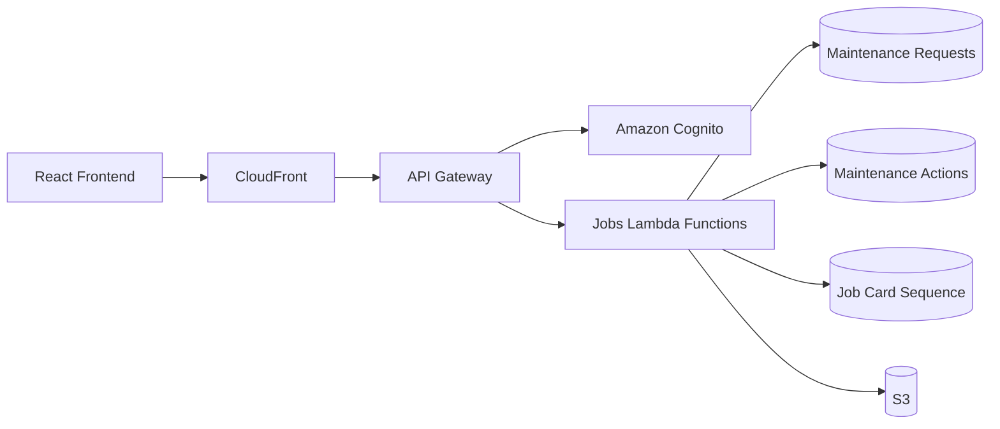

# Update Jobs Module README Documentation

## Objective

Update the existing `README.md` documentation for the **Jobs module** based on the actual implementation in this repository.

The current Jobs module already uses these sections:

```markdown
- [Overview](#overview)
- [Problem](#problem)
- [Solution](#solution)
- [User Experience](#user-experience)
- [Scope](#scope)
- [Architecture](#architecture)
- [Infrastructure](#infrastructure)
- [Prerequisites](#prerequisites)
- [Open Questions](#open-questions)
```

## Important

Keep this existing structure.

Do **not** replace these sections with a completely new README structure.

You may add appropriate **subsections under these existing headings** where this improves readability, especially under:

- Architecture
- Infrastructure
- Solution
- User Experience

Only update the Jobs module section of the existing `README.md`.

---

# Critical Scope Restriction

Only modify:

```text
README.md
```

and only the content related to the **Jobs module**.

Do NOT modify:

- Lambda code
- Terraform
- API Gateway resources
- DynamoDB resources
- frontend code
- shared utilities
- YAML/OpenAPI files
- deployment scripts
- package files
- any other documentation
- README sections belonging to other modules

This is a documentation-only task.

Do not fix code, refactor code, or change infrastructure even if issues are discovered.

---

# Investigation Before Updating README

Before writing documentation, inspect the current Jobs implementation.

Trace the actual relationships between:

```text
Frontend
   ↓
CloudFront
   ↓
API Gateway
   ↓
Cognito Authorizer
   ↓
Lambda
   ↓
DynamoDB / S3 / Notifications
```

Also inspect the workflow between:

```text
Maintenance Request
        ↓
Approval / Rejection
        ↓
Technician Assignment
        ↓
Maintenance Action
        ↓
Completion
        ↓
Job Card Creation
        ↓
PDF / S3
```

Do not assume this flow is exact.

Verify it against the current implementation.

---

# Overview

Update the existing `Overview` section with a concise description of the Jobs module.

Explain that the module manages the maintenance job lifecycle, including where applicable:

- maintenance requests
- approval/rejection
- technician assignment
- maintenance actions
- job status tracking
- completion
- job card generation
- supporting comments/notifications

Keep this section high level.

Do not put detailed implementation information here.

---

# Problem

Preserve the current intent of the `Problem` section.

Improve it only where required to accurately describe the operational problem the Jobs module solves.

Focus on issues such as:

- manual maintenance request tracking
- limited visibility of job status
- assignment and accountability
- maintenance history
- job completion records
- maintenance costs
- job card generation
- centralised maintenance records

Do not invent business requirements that cannot be supported by the existing README or implementation.

---

# Solution

Expand the existing `Solution` section to describe how the Jobs module solves the problem.

Document the workflow at a functional level.

For example:

```text
Maintenance request submitted
        ↓
Pending review
        ↓
Approved or rejected
        ↓
Technician assigned
        ↓
Maintenance work captured
        ↓
Job completed
        ↓
Job card generated
```

Use the actual statuses and workflow found in the code.

Where useful, add subsections such as:

```markdown
### Job Creation

### Approval and Assignment

### Rejection

### Maintenance Action

### Job Completion

### Job Card Generation
```

Do not create these subsections if they would duplicate existing content unnecessarily.

---

# User Experience

Update this section from the user's perspective rather than from an AWS architecture perspective.

Explain the experience for the relevant user roles.

Inspect the implementation and document roles such as:

- admin
- technician
- manager
- user
- contractor

Only include roles that actually interact with Jobs.

Describe actions such as:

- submitting a maintenance request
- viewing jobs
- filtering jobs
- approving/rejecting jobs
- assigning technicians
- updating maintenance actions
- completing jobs
- viewing/downloading job cards
- adding/viewing comments

Also explain access restrictions where applicable.

For example:

```text
Admin / Technician
→ broader access to maintenance jobs.

Managers / standard users
→ access constrained according to location, ownership, submitted requests or current implementation.
```

Verify the real authorization logic before documenting it.

---

# Scope

Update the `Scope` section so that it clearly defines what belongs to the Jobs module.

Include relevant components such as:

- maintenance requests
- job lifecycle/statuses
- approvals/rejections
- technician assignments
- maintenance actions
- comments if applicable
- job card numbering
- PDF job cards
- maintenance-related S3 uploads
- notifications if used

Clearly exclude unrelated modules such as:

- asset transfers
- disposals
- asset management

unless there is a direct integration with Jobs that needs mentioning.

---

# Architecture

This should become the primary technical overview of the Jobs module.

Inspect the actual repository and document how the components interact.

Add suitable subsections such as:

```markdown
### Request Flow

### Job Lifecycle

### Authentication and Authorization

### Job Card Flow
```

if appropriate.

## Request Flow

Document the actual path of a Jobs request.

For example:

```text
React Frontend
      ↓
CloudFront
      ↓
API Gateway
      ↓
Cognito Authorizer
      ↓
Jobs Lambda
      ↓
DynamoDB
```

Where applicable, also show:

```text
Lambda
   ├── S3
   ├── SQS
   ├── EventBridge
   └── other supporting services
```

Do not include services that are not actually used by Jobs.

---

# Simple Architecture Diagram

Add a basic Mermaid diagram under `Architecture`.

Keep it simple because I will create/refine the final architecture diagram separately.

For example:



Do not blindly use this diagram.

Update it to match the actual implementation found in the repository.

Keep it architecture-level rather than showing every Lambda function.

---

# Job Lifecycle

Under `Architecture` or `Solution`, document the actual job lifecycle.

Inspect all Jobs-related Lambda functions and determine the valid statuses and transitions.

For example only:

```text
Pending
   ↓
Approved
   ↓
In Progress
   ↓
Completed
```

with rejection as a separate branch.

Do not use these statuses unless verified.

Explain which action or Lambda is responsible for each important transition.

---

# Authentication and Authorization

Document how Jobs endpoints are protected.

Inspect:

- API Gateway authorizers
- Cognito configuration
- JWT/ID token claims
- Cognito groups
- Lambda authorization logic
- user `sub`
- location restrictions

Potential claims may include:

```text
sub
cognito:groups
name
family_name
```

Only document claims actually used.

Explain the permission model in plain technical language.

---

# Infrastructure

Expand this section substantially.

It should document the AWS resources supporting the Jobs module.

Use appropriate subsections such as:

```markdown
### API Gateway

### Lambda Functions

### DynamoDB

### Amazon S3

### Cognito

### Notifications
```

Only include infrastructure actually used by Jobs.

---

# API Gateway

Find all Jobs-related routes.

Produce a table:

| Method | Route | Lambda | Authentication | Purpose |
| ------ | ----- | ------ | -------------- | ------- |

Examples might include:

```text
POST /api/jobs
GET /api/jobs
GET /api/jobs/{id}
POST /api/jobs/{id}/approve
POST /api/jobs/{id}/reject
```

These are examples only.

Use the exact routes defined in the repository.

Do not infer routes from Lambda filenames.

Include maintenance-action, comments and job-card endpoints if they are part of the Jobs module.

---

# Lambda Functions

Identify all Lambda functions involved in the Jobs workflow.

For each important function document:

| Lambda | Purpose | Main Resources |
| ------ | ------- | -------------- |

Include functions responsible for areas such as:

- creating maintenance requests
- retrieving jobs
- retrieving a job by ID
- approving jobs
- rejecting jobs
- creating/updating maintenance actions
- completing jobs
- generating job cards
- downloading/retrieving job cards
- comments
- supporting notifications

Use actual function names.

Avoid documenting internal implementation line by line.

---

# DynamoDB

Document every DynamoDB table directly used by the Jobs module.

For each relevant table include:

- purpose
- partition key
- sort key
- GSIs
- relationship to other Jobs data

Pay particular attention to the maintenance-request table.

Verify whether indexes such as these exist:

```text
StatusIndex
LocationIndex
ActionIdIndex
```

Do not add them unless confirmed.

Also inspect supporting tables such as:

```text
maintenance-action
comments
users
jobcard-sequence
notifications
```

and include only those directly involved in Jobs.

A concise table is preferred:

| Table | Keys | Indexes | Purpose |
| ----- | ---- | ------- | ------- |

---

# Job Data Model

Add a concise representation of the important maintenance request/job fields.

Inspect DynamoDB writes and Lambda payloads rather than guessing.

Potential fields include:

```text
id
jobCreated
jobNo
status
location
requested_by
requested_by_sub
assign_to_sub
assign_to_name
assign_to_group
targetDate
approved_at
actionId
```

These are examples only.

Document the fields actually used.

Do not list every incidental field if it harms readability.

---

# Maintenance Actions

Document how maintenance actions relate to a maintenance request.

Determine:

- which DynamoDB table stores them
- how they reference the maintenance request
- whether the request stores an `actionId`
- what Lambda creates the action
- what information is captured
- when the job status changes

A simple relationship diagram may be useful:

```text
Maintenance Request
        │
        └── actionId
               ↓
        Maintenance Action
```

Verify this relationship before documenting it.

---

# Job Card Number Generation

Inspect the actual job-card sequence implementation.

Document:

- DynamoDB sequence table
- how the sequence is incremented
- location/site code
- year/month component
- sequence number
- resulting job number

If the current implementation uses:

```text
Job-<SiteCode>-<YYYYMM>-####
```

document it.

Example only:

```text
Job-CTS-202610-0001
```

Do not use this format unless confirmed by the code.

Explain briefly why a separate sequence table is used, particularly if it provides atomic sequential number generation.

---

# Job Card PDF Generation

Trace the actual job completion process.

Document:

```text
Maintenance Action
        ↓
Job completed
        ↓
Job card data assembled
        ↓
PDF generated
        ↓
Stored in S3
        ↓
Available for retrieval/download
```

Verify:

- which Lambda generates it
- when it is generated
- what data is included
- S3 bucket/prefix
- how it is retrieved

Do not invent fields or behaviour.

---

# Amazon S3

Document only Jobs-related storage.

Inspect the implementation for prefixes such as:

```text
maintenance/
jobcards/
```

Verify actual paths.

Explain:

- maintenance images
- presigned uploads if applicable
- generated job cards
- download/retrieval behaviour

Do not document asset transfer or disposal storage unless Jobs directly uses it.

---

# Comments

If comments belong to the Jobs module, document:

- comments table
- partition/sort keys
- relevant API routes
- relationship to the maintenance request
- ordering/timestamps
- authorization rules

Keep this concise.

---

# Notifications / Events

Determine whether Jobs currently integrates with:

- SQS
- EventBridge
- SNS
- notifications DynamoDB table
- another notification mechanism

Document only the actual implementation.

Identify events such as:

```text
Job created
Job approved
Job rejected
Job assigned
Job completed
```

only if they generate notifications in the current codebase.

Do not copy notification architecture from the Transfers module unless Jobs actually uses it.

---

# Prerequisites

Preserve the existing `Prerequisites` section.

Update it only where necessary.

Include prerequisites that someone needs in order to work with or deploy this module, such as:

- AWS account/configuration
- Terraform where relevant
- Cognito
- existing DynamoDB tables
- S3 bucket
- API Gateway
- required environment variables

Do not turn this into a complete project installation guide.

---

# Open Questions

Preserve the existing `Open Questions` section.

Do not invent problems merely to populate it.

If inspection of the current implementation reveals genuine uncertainties, inconsistencies or undocumented decisions, place them here.

Examples:

```text
- Is <behaviour> intentional?
- Should <legacy route> still be supported?
- Is <status> still actively used?
```

Do not modify code to resolve these questions.

If there are no legitimate open questions, retain the section and indicate that no current documentation questions were identified.

---

# Documentation Style

The README should explain the module to:

- another developer joining the project
- an engineer troubleshooting the workflow
- an architecture reviewer
- someone reviewing the project as a portfolio project

Keep the language technical but concise.

Prioritise:

```text
What exists
What it does
How it connects
What data it stores
How the job lifecycle works
```

Avoid excessive implementation details.

---

# Accuracy Requirements

Do not document behaviour from memory or assumptions.

Trace:

```text
API Route
   ↓
Lambda
   ↓
DynamoDB
   ↓
S3 / notification / other side effects
```

Where filenames, comments and implementation disagree, use the current implemented behaviour.

Do not change documentation to describe how the system ideally should work.

Document how it currently works.

---

# Final Verification

Before finishing:

1. Confirm only `README.md` was modified.
2. Confirm only the Jobs module portion was modified.
3. Confirm all existing top-level Jobs README sections were retained.
4. Confirm no Terraform files were changed.
5. Confirm no Lambda files were changed.
6. Confirm no frontend files were changed.
7. Confirm every documented API route exists.
8. Confirm every documented Lambda exists.
9. Confirm DynamoDB keys/indexes against the implementation.
10. Confirm status values against the implementation.
11. Confirm job-card number generation against the implementation.
12. Confirm S3 paths against the implementation.
13. Remove all unverified assumptions.

At completion return:

```text
README updated:
<README path>

Existing sections retained:
- Overview
- Problem
- Solution
- User Experience
- Scope
- Architecture
- Infrastructure
- Prerequisites
- Open Questions

Jobs documentation expanded with:
- Current architecture
- Job lifecycle
- Authentication/authorization
- API routes
- Lambda responsibilities
- DynamoDB tables/indexes
- Maintenance actions
- Job-card numbering
- PDF generation
- S3 integration
- Notifications/comments where applicable

Files modified:
- README.md

No application or infrastructure code was modified.
```

# Frontend Review

- Task 1: Go through the list of actions from the frontend and return a report only.
- Highlight if any inconsitencies are mistakes or incompatible behavior.

The backend team should confirm and address the following remaining items:

1. Rejection behavior and status casing
   The backend deletes a request only for exact "Rejected", while lowercase "rejected" retains it. The frontend currently sends lowercase.
   Backend must confirm whether rejection should:
   - Permanently delete the request, or
   - Retain it as rejected for audit/history.
     Status casing should then be normalized server-side rather than controlling destructive behavior.
2. Broken or incomplete PUT update endpoint
   The documentation states that updateJobById supplies only id, although the DynamoDB table requires both id and jobCreated.
   Backend must:
   - Correct the DynamoDB key lookup.
   - Confirm whether pending and in-progress jobs can both be updated.
   - Publish the exact update-field whitelist.
   - Confirm support for multi-asset assets.
   - Confirm support for deleted_image_keys.
   - Confirm the response format for new presigned_urls.
3. Canonical Cognito groups
   The backend documentation includes:
   - technician
   - contractor
   - maintenance
     The frontend currently treats maintenance as the actioning group and does not recognize technician as a Cognito group.
     Backend must confirm whether technicians are:
   - Members of the maintenance group with position: technician, or
   - Members of a separate technician Cognito group.
     One canonical group model should be used across Cognito, user APIs, and frontend authorization.
4. Contractor and technician assignment sources
   Approval supports assign_to_group, assign_to_sub, and assign_to_name, but the frontend currently has only /api/users/technicians as an assignee source.
   Backend must confirm or provide:
   - A contractor-list endpoint.
   - Whether other is a supported assignment group.
   - Whether one combined assignable-users endpoint should be used.
   - The required relationship between group, name, and Cognito sub.
5. Assignee authorization
   The action endpoint currently accepts an action from any authenticated caller, regardless of assign_to_sub and assign_to_group.
   Backend must confirm whether only the assigned technician or contractor may action a job. If so, this must be enforced in the Lambda; frontend controls are not sufficient security.
6. Authorization for sensitive endpoints
   The following handlers authenticate users but do not enforce roles, ownership, location, or assignment:
   - Approve
   - Reject
   - Action
   - Detail
   - Update
   - Delete
   - Comments
   - Job-card download
     Backend must define and enforce the authorization matrix. In particular, update and delete operations should not depend solely on frontend button visibility.
7. Allowed status values and transitions
   Approval and action handlers accept arbitrary status strings. The frontend action form currently permits cancelled, in progress, and complete, while only complete sets completed_at and generates a PDF.
   Backend must confirm:
   - Valid statuses for each endpoint.
   - Whether an action record may be submitted without completing the job.
   - Whether cancelled is a supported lifecycle state.
   - Which transitions are legal.
   - Whether status matching is case-sensitive.
     Invalid transitions should be rejected server-side.
8. Completed-list semantics
   /api/jobs/completed returns maintenance-action records, but action submission can currently use non-complete statuses.
   Backend must confirm whether the endpoint:
   - Returns every action record, or
   - Returns only records whose status is complete.
9. Exact response fields by lifecycle stage
   Pending requests do not yet have jobcardNumber or completed_at, while approved and completed records do.
   Backend should publish separate response contracts for:
   - Pending request
   - In-progress request
   - Completed-action list item
   - Merged completed detail
     It should also confirm whether multi-asset records omit legacy root-level assetID, area, and equipment fields.
10. File-upload response contract
    Backend must confirm the exact presigned_urls structure for:
    - Nested request asset images
    - Action images
    - Invoices
    - Updated request images
      Each entry should consistently identify its file type and, for request images, the related assetIndex.
11. Deletion and rejection file cleanup
    Current deletion only cleans up legacy top-level request images.
    Backend should also determine whether to remove:
    - Nested assets[n].images
    - Action images
    - Invoices
    - Generated job-card PDFs
12. Notification Lambda behavior
    The documented notification handler currently:
    - Processes more than request-insert events.
    - Describes every event as a new pending request.
    - Sends to the requestor rather than a configured administrator.
    - Generates a localhost link.
      Backend must restrict the intended stream events, confirm recipients, and use the deployed frontend URL.

# Backend review

The frontend review is valid. All 12 findings are supported by the backend code; several are confirmed defects or security gaps, while a few require explicit business decisions before implementation.

| #   | Finding                          | Verdict                               | Backend recommendation                                                                                                                                                                                                                                                                                                |
| --- | -------------------------------- | ------------------------------------- | --------------------------------------------------------------------------------------------------------------------------------------------------------------------------------------------------------------------------------------------------------------------------------------------------------------------- |
| 1   | Rejection behavior               | **Incompatible and unsafe**           | Retain rejected requests for audit. Normalize input to lowercase and conditionally transition `pending → rejected`. Reserve permanent removal for the DELETE endpoint. Destructive behavior must never depend on casing.                                                                                              |
| 2   | PUT update endpoint              | **Confirmed broken**                  | The request table requires `id + jobCreated`, but `updateJobById` supplies only `id`. Replace its asset-oriented whitelist and define a proper multi-asset request update contract.                                                                                                                                   |
| 3   | Cognito groups                   | **Confirmed inconsistency**           | `getTechnicianList` actually reads the `maintenance` group, although both `maintenance` and `technician` groups are configured. Adopt `maintenance` as the permission group and use `position: technician` for classification, or fully migrate to a separate `technician` group. Do not retain both interpretations. |
| 4   | Assignment sources               | **Existing endpoint is incompatible** | `/api/users/contractors` exists, but its contractor model contains asset-like fields and no Cognito `sub`, so it cannot satisfy `assign_to_sub`. Introduce one identity-based assignable-users contract.                                                                                                              |
| 5   | Assignee authorization           | **Confirmed security defect**         | Only the assigned identity—or an explicitly authorized admin override—should be able to action a job. Enforce this in `postJobAction` using `assign_to_sub`, not frontend visibility.                                                                                                                                 |
| 6   | Sensitive endpoint authorization | **Confirmed security defect**         | Cognito authentication alone is insufficient. Add a server-side authorization matrix for approval, rejection, action, detail, update, delete, comments, and job-card access.                                                                                                                                          |
| 7   | Status validation                | **Confirmed validation defect**       | Define a canonical lowercase state machine. Reject unsupported values and invalid transitions with `409 Conflict`.                                                                                                                                                                                                    |
| 8   | Completed-list semantics         | **Confirmed semantic mismatch**       | `/api/jobs/completed` currently returns every action record. It should query/filter only `status = complete`, or be renamed to represent all actions.                                                                                                                                                                 |
| 9   | Response contracts               | **Confirmed contract gap**            | Publish separate schemas for pending requests, in-progress requests, completed action rows, and merged completed detail. New multi-asset requests legitimately omit legacy root-level `assetID`, `area`, and `equipment`.                                                                                             |
| 10  | Upload response contract         | **Partially implemented**             | Creation and action endpoints return different upload-entry shapes; PUT returns no upload URLs. Define one shared file descriptor and implement the update path explicitly.                                                                                                                                           |
| 11  | File cleanup                     | **Confirmed incomplete cleanup**      | Deletion and rejection only inspect legacy top-level `images`. Nested asset images, action files, invoices, and job-card PDFs can be orphaned.                                                                                                                                                                        |
| 12  | Notification Lambda              | **Confirmed functional defect**       | Restrict processing to request INSERT events, use the intended administrator recipient, and generate the deployed frontend URL. The current implementation can mislabel MODIFY events and emails the requestor.                                                                                                       |

## Evidence and decisions

### 1. Rejection should retain history

[`postRejectRequest.py`](C:/Users/user/Documents/Atlantic%20Meat/backend/aws-cloud-projects/Testing/03_Testing_CRUD_NoSQL/lambdas/jobs/postRejectRequest/postRejectRequest.py:128) compares the raw status with exact `"Rejected"`. That spelling deletes the request; lowercase `"rejected"` follows the update path.

Because the platform’s purpose includes traceability and maintenance history, the recommended contract is:

```text
POST /api/jobs/{id}/reject
pending → rejected
```

It should store `reject_message`, `rejected_at`, `rejected_by`, and `rejected_by_sub`. Actual deletion should be a separate, admin-only operation.

### 2. PUT cannot currently update the request table

[`updateJobById.py`](C:/Users/user/Documents/Atlantic%20Meat/backend/aws-cloud-projects/Testing/03_Testing_CRUD_NoSQL/lambdas/jobs/updateJobById/updateJobById.py:57) calls DynamoDB with `Key={"id": request_id}`, while the configured table uses `id + jobCreated`.

Its whitelist is also inherited from an asset model: warranty, serial number, manufacturer, model, and similar fields. It does not support:

- `assets`
- Nested asset images
- `deleted_image_keys`
- New upload requests
- `presigned_urls`

Recommended policy:

- Request owner may edit a `pending` request.
- Admin/maintenance may edit `pending`.
- Once `in progress`, only narrowly defined administrative fields should be editable.
- Completed/rejected requests should be immutable.
- Look up `jobCreated`, then perform a conditional update against the full key and expected status.

### 3. Canonical group model

[`getTechnicianList.py`](C:/Users/user/Documents/Atlantic%20Meat/backend/aws-cloud-projects/Testing/03_Testing_CRUD_NoSQL/lambdas/getTechnicianList/getTechnicianList.py:9) lists users from Cognito group `maintenance`, not `technician`. However, both groups exist in [`terraform.tfvars`](C:/Users/user/Documents/Atlantic%20Meat/backend/aws-cloud-projects/Testing/03_Testing_CRUD_NoSQL/terraform.tfvars:4099).

The cleanest model is:

```text
Cognito group: maintenance
User position: technician | supervisor | maintenance manager
```

Use groups for authorization and `position` for business classification. Remove or stop issuing the separate `technician` group unless it has genuinely different permissions.

Contractors require a separate decision. The current contractor table is not an identity store: [`postCreateContractor.py`](C:/Users/user/Documents/Atlantic%20Meat/backend/aws-cloud-projects/Testing/03_Testing_CRUD_NoSQL/lambdas/contractors/postCreateContractor/postCreateContractor.py:49) captures asset-style fields and no Cognito identity.

If contractors log in and action work, they need a Cognito `sub`. If they do not log in, assign both:

```text
contractor_id       external vendor/person
assign_to_sub       accountable internal authenticated user
```

Do not support `other` as an arbitrary assignment group.

### 4. Recommended authorization matrix

| Operation                     | Recommended authorization                                                 |
| ----------------------------- | ------------------------------------------------------------------------- |
| Create request                | Any authenticated user                                                    |
| List requests                 | Owner; admin/maintenance all; manager by explicitly defined location rule |
| View detail/comments/job card | Requestor, assigned user, admin/maintenance; location manager if required |
| Update pending request        | Requestor or admin/maintenance                                            |
| Approve/reject                | Admin or designated maintenance approver                                  |
| Submit action                 | `sub == assign_to_sub`, with audited admin override                       |
| Delete                        | Admin only, preferably only pending/rejected                              |
| Download job card             | Same access as completed-job detail                                       |

Location-based access cannot safely be introduced until the backend defines its source of truth—token claim versus users-table lookup.

### 5. Recommended lifecycle

```text
pending ──approve──> in progress ──complete──> complete
    │
    └──reject──> rejected
```

If cancellation is a real requirement:

```text
pending | in progress ──cancel──> cancelled
```

Recommended endpoint rules:

- Approval accepts an action/decision, not an arbitrary target status.
- Rejection always writes `rejected`.
- `postJobAction` should complete the job only with `complete`.
- If work-in-progress drafts are needed, add an action draft/update endpoint rather than inserting nominally “completed” action records with `in progress`.
- All stored statuses should be lowercase.
- Conditional expressions should enforce the expected previous state.

[`postJobAction.py`](C:/Users/user/Documents/Atlantic%20Meat/backend/aws-cloud-projects/Testing/03_Testing_CRUD_NoSQL/lambdas/jobs/postJobAction/postJobAction.py:289) currently accepts arbitrary normalized text; only `complete` sets `completed_at`. [`getJobsCompletedList.py`](C:/Users/user/Documents/Atlantic%20Meat/backend/aws-cloud-projects/Testing/03_Testing_CRUD_NoSQL/lambdas/jobs/getJobsCompletedList/getJobsCompletedList.py:110) does not filter by action status.

### 6. Recommended upload descriptor

Use one common response shape:

```json
{
  "type": "request_image | action_image | invoice",
  "filename": "photo.webp",
  "content_type": "image/webp",
  "key": "maintenance/request-id/assets/0/images/photo.webp",
  "url": "https://...",
  "assetIndex": 0
}
```

`assetIndex` should be required only for request asset images. An update response should return:

```json
{
  "data": {},
  "presigned_urls": [],
  "deleted_image_keys": []
}
```

### 7. Notification correction

[`jobs-notify-admin.py`](C:/Users/user/Documents/Atlantic%20Meat/backend/aws-cloud-projects/Testing/03_Testing_CRUD_NoSQL/lambdas/jobs-notify-admin/jobs-notify-admin.py:18) reads the first `NewImage` without checking `eventName` or status. It sends to `user_email` and builds a localhost URL.

Recommended behavior:

- Process every batch record, not only the first.
- Accept only `INSERT` records whose status is `pending`.
- Send to a configured admin/maintenance recipient or distribution list.
- Read the frontend base URL from configuration.
- Make delivery idempotent to prevent duplicate emails during stream retries.

## Recommended implementation order

1. Fix authorization for action, approve, reject, update, delete, detail, comments, and job cards.
2. Normalize and enforce the status lifecycle; make rejection non-destructive.
3. Repair or temporarily disable PUT until its contract is implemented.
4. Standardize Cognito groups and assignment identities.
5. Filter the completed list and publish response/upload schemas.
6. Complete S3 cleanup.
7. Correct notification filtering, recipients, batching, and URLs.

No files were modified; this was a review-only pass.
