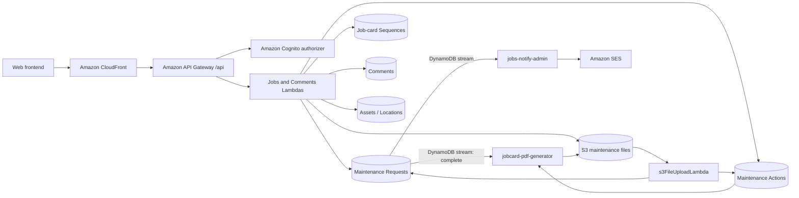
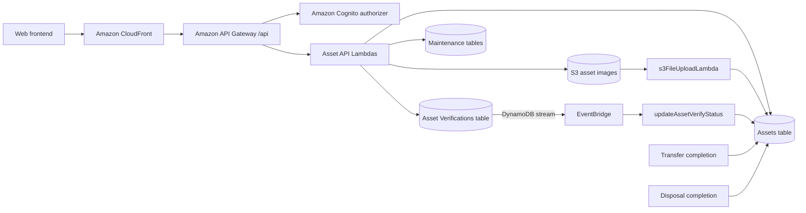
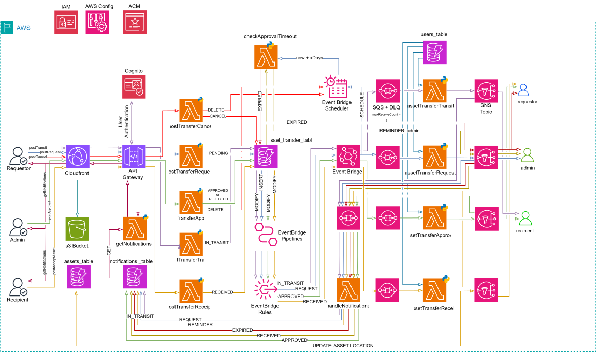

# Atlantic Meats Project

A custom-built asset and maintenance management system designed specifically for a Atlantic Meats to streamline the management of assets across multiple store locations. The platform centralises all maintenance activity into a single digital system, replacing manual WhatsApp tracking methods with structured, traceable job cards and a unified asset register.

It provides a consolidated view of all assets across stores, enabling clear visibility into maintenance history, ongoing work, and asset performance. Each maintenance action is recorded digitally, ensuring a complete and reliable history of work performed on every asset.

# Aim of the Platform

The primary aim is to reduce maintenance expenditure and improve the efficiency and accuracy of asset management across all customer store locations.

Key objectives include:

- Reducing overall maintenance spend through improved visibility and preventative insights
- Providing store-level and asset-level insights into maintenance activity and recurring issues
- Centralising asset management across all customer locations into a single system
- Replacing manual processes with digital job cards for consistent and traceable maintenance records
- Maintaining a complete maintenance history per asset to support troubleshooting and decision-making
- Identifying patterns and root causes of recurring faults to enable long-term corrective actions

# Table of Contents

- [Introduction](#introduction)
- [Tech Stack](#tech-stack)
- [Feautures](#features)
- [Project Structure](#project-structure)
- [Installation](#installation)
  - [Clone the Repository](#clone-the-repository)
  - [Navigate to the project](#navigate-to-the-project)
  - [Install Dependencies](#install-dependencies)
  - [Start Development Server](#start-development-server)
- [Environment Variables](#environment-variables)
- [Github Secrets](#github-secrets)
- [Available Scripts](#available-scripts)
- [Build](#build)
- [Deployment](#deployment)
- [EsLint Configuration](#eslint-configuration)
- [Usage](#usage)
- [API Reference](#api-reference)
- [Security](#security)

- [Application Modules](#application-modules)
  - [Jobs Module](#jobs-module)
    - [Overview](#overview)
    - [Problem](#problem)
    - [Solution](#solution)
    - [User Experience](#user-experience)
    - [Scope](#scope)
    - [Architecture](#architecture)
    - [Infrastructure](#infrastructure)
    - [Prerequisites](#prerequisites)
    - [Open Questions](#open-questions)

  - [Assets Module](#assets-module)
    - [Overview](#overview)
    - [Problem](#problem)
    - [Solution](#solution)
    - [User Experience](#user-experience)
    - [Scope](#scope)
    - [Architecture](#architecture)
    - [Key Design Principles](#key-design-principles)
    - [Data Model](#data-model)
    - [Infrastructure](#infrastructure)
    - [Prerequisites](#prerequisites)
    - [Open Questions](#open-questions)

  - [Assets Transfer Module](#assets-transfer-module)
    - [Overview](#overview)
    - [Problem](#problem)
    - [Solution](#solution)
    - [User Experience](#user-experience)
    - [Scope](#scope)
    - [Architecture](#architecture)
    - [Key Design Principles](#key-design-principles)
    - [Data Model](#data-model)
    - [Infrastructure](#infrastructure)
    - [Prerequisites](#prerequisites)
    - [Open Questions](#open-questions)
    - [Architecture Review Notes & Recommendations](#architecture-review-notes--recommendations)

  - [Asset Disposal Module](#asset-disposal-module)
    - [Overview](#overview)
    - [Problem](#problem)
    - [Solution](#solution)
    - [User Experience](#user-experience)
    - [Scope](#scope)
    - [Architecture](#architecture)
    - [Infrastructure](#infrastructure)
    - [Prerequisites](#prerequisites)
    - [Open Questions](#open-questions)

  - [Comments Module](#comments-module)
    - [Overview](#overview)
    - [Problem](#problem)
    - [Solution](#solution)
    - [User Experience](#user-experience)
    - [Scope](#scope)
    - [Architecture](#architecture)
    - [Infrastructure](#infrastructure)
    - [Prerequisites](#prerequisites)
    - [Open Questions](#open-questions)

  - [Users Module](#users-module)
    - [Overview](#overview)
    - [Problem](#problem)
    - [Solution](#solution)
    - [User Experience](#user-experience)
    - [Scope](#scope)
    - [Architecture](#architecture)
    - [Infrastructure](#infrastructure)
    - [Prerequisites](#prerequisites)
    - [Open Questions](#open-questions)

  - [Notifications Module](#notifications-module)
    - [Overview](#overview)
    - [Problem](#problem)
    - [Solution](#solution)
    - [User Experience](#user-experience)
    - [Scope](#scope)
    - [Architecture](#architecture)
    - [Infrastructure](#infrastructure)
    - [Prerequisites](#prerequisites)
    - [Open Questions](#open-questions)

- [Contact](#contact)

---

# Tech Stack

- React
- TypeScript
- Vite
- Tailwind CSS
- React Router Dom
- React Query
- AWS
- Terraform

# Features

- User authentication
- Responsive dashboard
- API integration
- Github actions deployment
- Role-based access

# Project Structure

```bash
src/
├── assets/
├── auth/
├── components/
├── context/
├── data/
├── hooks/
├── lib/
├── pages/
├── routes/
├── schemas/
├── styles/
└── utils/
```

---

# Installation

## Clone the repository

```bash
git clone https://github.com/Fabian-Petersen/atlantic-meats-app-fabian-portfolio.git
```

## Navigate to the project

```bash
cd atlantic-meats-app
```

## Install dependencies

```bash
npm install
```

## Start development server

```bash
npm run dev
```

Application runs on:

```bash
http://localhost:5173
```

---

# Environment Variables

Create a `.env` file in the root directory:

```env
VITE_COGNITO_USERPOOL_ID=
VITE_COGNITO_CLIENT_ID=
VITE_SITE_URL=
```

# Github Secrets

API_GATEWAY_URL=
AWS_ACCESS_KEY_ID=
AWS_S3_BUCKET=
AWS_SECRET_ACCESS_KEY=
CLOUDFRONT_DISTRIBUTION_ID=
COGNITO_CLIENT_ID=
COGNITO_USERPOOL_ID=

---

# Available Scripts

| Command           | Description              |
| ----------------- | ------------------------ |
| `npm run dev`     | Start development server |
| `npm run build`   | Create production build  |
| `npm run preview` | Preview production build |
| `npm run lint`    | Run ESLint               |

---

# Build

```bash
npm run build
```

Production files are generated in:

```bash
dist/
```

---

# Deployment

Example deployment platforms:

- AWS Amplify
- AWS S3 + CloudFront

---

# ESLint Configuration

This project uses ESLint with TypeScript support.

Example plugins:

- eslint-plugin-react
- eslint-plugin-react-hooks
- typescript-eslint

---

# Usage

Content here...

---

# API Reference

Content here...

---

# Security

Security is addressed in layers, following AWS's defense-in-depth model, each layer assumes the one in front of it could fail. The table of contents below maps each layer to the services already present in this architecture (API Gateway, Lambda, DynamoDB, Cognito, S3/CloudFront, EventBridge/SQS/SNS) plus the additional AWS services that close the remaining gaps.

## Perimeter & Network

| Service                       | Purpose                                                                                             |
| ----------------------------- | --------------------------------------------------------------------------------------------------- |
| AWS WAF                       | Blocks common web exploits (SQLi, XSS, bad bots) at CloudFront/API Gateway before they reach Lambda |
| CloudFront                    | Enforces HTTPS-only access, restricts direct S3 access via Origin Access Control (OAC)              |
| AWS Shield (Standard)         | DDoS protection, included by default on CloudFront and API Gateway at no extra cost                 |
| API Gateway Resource Policies | Optionally restrict API access by IP range or VPC endpoint where applicable                         |

**Why it matters here:** CloudFront and API Gateway are the only public entry points into the system. WAF is the cheapest, highest-leverage control to add — it stops malformed or malicious requests before they ever invoke a Lambda or touch DynamoDB.

## Identity & Access

| Service                        | Purpose                                                                                           |
| ------------------------------ | ------------------------------------------------------------------------------------------------- |
| Cognito                        | Authentication, MFA, and issuing JWTs consumed by API Gateway authorizers                         |
| IAM                            | Least-privilege execution roles per Lambda, scoped to specific table/topic/queue ARNs             |
| Cognito Groups / Custom Claims | Role-based access (admin, user, manager) enforced in Lambda authorization logic                   |
| AWS Parameter Store            | Stores any third-party credentials (e.g. WhatsApp/Meta API keys) instead of environment variables |

**Why it matters here:** this is the layer with the most existing history of friction (the noted `EntityAlreadyExists` IAM issues). Each Lambda should have its own role with only the specific actions and ARNs it needs — a shared broad role is both a security risk and the more likely source of naming collisions during `terraform apply`. Enforcing MFA on Cognito for admin-role users specifically (not necessarily all users) is a low-cost, high-value addition given admins can approve/reject transfers.

## Data Protection

| Service                                  | Purpose                                                                                                                               |
| ---------------------------------------- | ------------------------------------------------------------------------------------------------------------------------------------- |
| KMS                                      | Encryption at rest for DynamoDB tables, S3 buckets, and SQS/SNS — customer-managed keys (CMKs) where audit trail of key usage matters |
| DynamoDB encryption at rest              | Enabled by default (AWS-owned key); upgrade to a CMK if you need to control/revoke access independently                               |
| S3 Bucket Policies + Block Public Access | Prevents accidental public exposure of uploaded images (invoices, damage photos, delivery notes)                                      |
| TLS / HTTPS everywhere                   | Enforced via CloudFront and API Gateway; no plaintext HTTP path should exist                                                          |

**Why it matters here:** the transfer workflow stores images (`invoiceUrl`, `imageUrls`, `deliveryNoteUrl`) and PII (Cognito subs, names). A CMK on the S3 bucket holding these gives you the ability to revoke access or rotate keys independently of AWS-managed defaults, and CloudTrail will log every key usage for audit purposes.

## Application & Compute

| Service                                            | Purpose                                                                                                                           |
| -------------------------------------------------- | --------------------------------------------------------------------------------------------------------------------------------- |
| Lambda execution roles (least privilege)           | Already covered under IAM above — re-stated here as it's enforced at the compute layer                                            |
| Lambda environment variable encryption             | KMS-encrypts env vars containing config/secrets                                                                                   |
| Dependency scanning (e.g. `pip-audit`, Dependabot) | Catches known vulnerabilities in Python Lambda dependencies before deploy                                                         |
| API Gateway request validation                     | Rejects malformed payloads at the gateway, before Lambda invocation — reduces attack surface and cold-start cost on garbage input |

**Why it matters here:** with 12+ Lambdas in the transfer module alone, a vulnerable dependency or an overly-permissive role on any single function becomes the weakest link for the whole chain. Treating each Lambda as its own trust boundary keeps a compromise contained.

## Observability & Detection

| Service           | Purpose                                                                                                                                          |
| ----------------- | ------------------------------------------------------------------------------------------------------------------------------------------------ |
| AWS X-Ray         | Distributed tracing across API Gateway → Lambda → EventBridge → SNS/SQS, useful for both debugging and spotting anomalous call patterns          |
| CloudWatch Alarms | Alerts on DLQ depth, throttling, error rates, and unusual invocation spikes                                                                      |
| CloudTrail        | Records every API call made against the AWS account — who did what, when, from where. Foundational for any post-incident investigation           |
| GuardDuty         | Continuous threat detection (anomalous API calls, compromised credentials, crypto-mining behavior) across the account                            |
| AWS Config        | Tracks configuration changes and evaluates resources against rules (e.g. "is this S3 bucket public", "is this Lambda using an outdated runtime") |
| Security Hub      | Aggregates findings from GuardDuty, Config, and Inspector into a single dashboard with a security score                                          |

**Why it matters here:** X-Ray was already flagged as a gap in the Transfer Module's architecture review (for debugging notification delivery) — it pulls double duty as a security tool too, since unusual trace patterns can surface abuse. CloudTrail + GuardDuty + Config + Security Hub form a standard "always-on" baseline that costs relatively little and answers "did something bad happen, and what changed" without needing to instrument it yourself.

## Governance & Compliance

| Service                       | Purpose                                                                                                                          |
| ----------------------------- | -------------------------------------------------------------------------------------------------------------------------------- |
| IAM Access Analyzer           | Flags resources (S3 buckets, IAM roles, KMS keys) shared with entities outside the account                                       |
| AWS Trusted Advisor           | Surfaces security misconfigurations and cost/security trade-offs against AWS best practices                                      |
| Terraform `tfsec` / `checkov` | Static analysis on Terraform files to catch insecure configurations (open security groups, unencrypted resources) before `apply` |

**Why it matters here:** since infrastructure is already Terraform-managed, running `checkov` or `tfsec` in CI (you already have GitHub Actions deployment) catches misconfigurations at PR time rather than after they're live — cheapest point in the pipeline to fix them.

## Suggested Priority Order

Given this is a portfolio project rather than a production system handling real assets, the highest-leverage additions in rough priority order:

1. **IAM least-privilege per Lambda** — directly relevant given prior `EntityAlreadyExists` history; fix this while writing the Transfer module's Terraform.
2. **CloudTrail + GuardDuty** — near-zero setup effort, always-on detection, and a strong portfolio signal of security awareness.
3. **AWS WAF on CloudFront/API Gateway** — cheap, high-leverage perimeter control.
4. **X-Ray tracing** — already needed for the Transfer module's observability gap; reuse it for security visibility too.
5. **AWS Config + Security Hub** — slightly more setup, but ties everything above into a single dashboard — good for demonstrating a mature security posture end-to-end.

---

# Application Modules

## Jobs Module

### Overview

The Jobs module manages the maintenance-job lifecycle from request capture through approval, assignment, work recording, completion, and downloadable job-card generation. It stores the maintenance request and the technician or contractor's maintenance action separately, links them when work is submitted, and supports request/action images, invoices, comments, and a new-request email notification.

### Problem

Maintenance requests previously depended on informal, manual tracking such as WhatsApp conversations. That made it difficult to establish who requested or owned a job, whether work had been approved or completed, what it cost, and which maintenance history belonged to an asset or store.

The module provides a central record for:

- Requests, priorities, operational impact, and affected assets
- Approval, assignment, target dates, and accountability
- Work performed, findings, root cause, signatures, travel, parts, sundries, contractor costs, and invoices
- Current job status and completion time
- Comments and supporting photographs
- Consistently numbered PDF job cards

### Solution

The implemented workflow is:

```text
Authenticated user submits a request
        |
        v
pending
        |
        +---- approval + assignment ----> in progress
        |                                     |
        |                                     v
        |                            maintenance action recorded
        |                                     |
        |                                     v
        |                                  complete
        |                                     |
        |                                     v
        |                          PDF job card generated in S3
        |
        +---- exact status "Rejected" ----> request and legacy images deleted
```

#### Job Creation

`postJobRequest` validates the request and its non-empty `assets` array, verifies the normalized location against the locations table when that lookup is available, derives the requestor identity from Cognito claims, and creates a UUID-keyed request with status `pending`. Each asset must have an area and equipment value, and must provide either an `assetID` or a supported missing-barcode reason. An unidentified asset must include at least one image.

For each requested image the Lambda returns a one-hour presigned upload URL under `maintenance/{requestId}/assets/{assetIndex}/images/{filename}`. An S3-triggered Lambda later appends the uploaded object's bucket/key metadata to the matching nested asset.

#### Approval and Assignment

`postApproveRequest` requires a target date and assignee name, Cognito `sub`, and group. When its input status normalizes to `approved`, it stores the database status as `in progress`, records the approving user's name and `sub`, assigns the work, and creates a job-card number. A conditional write prevents a second approval from assigning another number.

#### Rejection

`postRejectRequest` has two current behaviours. With the exact case-sensitive status `Rejected`, it deletes the maintenance-request item and the legacy top-level images referenced by that item, returning rejection metadata only in the response. Any other supplied status is written to the request with `reject_message`. Rejected requests therefore are not retained when the frontend sends the expected `Rejected` value.

#### Maintenance Action and Completion

`postJobAction` records the authenticated actioning user's `sub` and name plus start/end time, distance travelled, work completed, root cause, findings, signature, signatory, parts, sundries, contractor details, and their costs. It can issue presigned uploads for action images and invoices.

The Lambda uses a DynamoDB transaction to create the maintenance-action record and update the request with the action's status, `action_id`, and `statusUpdatedAt`. The normal completion value is lowercase `complete`; that value also adds `completed_at` and triggers job-card generation through the maintenance-request stream.

#### Job Card Generation

On a request transition to `complete`, the container-image `jobcard-pdf-generator` Lambda reads the linked maintenance action, merges it with the request, renders a PDF, and writes `jobcards/{requestId}.pdf` to `crud-nosql-app-images`. Existing PDFs are not regenerated. `getJobcardById` accepts the action ID, resolves the request through `ActionIdIndex`, confirms that the PDF exists, and returns a ten-minute presigned download URL.

### User Experience

#### Requestors

Any authenticated user can submit a maintenance request, select a location/area/equipment/asset through the asset-options endpoint, describe the problem and impact, and upload supporting images. In list views, users outside the `admin` and `maintenance` Cognito groups see only requests whose `request_sub` matches their token `sub`.

#### Admin and Maintenance Users

Members of the `admin` or `maintenance` groups can list all maintenance requests and filter them by the exact stored status. Approval captures the target date and an assignee, moves the request to `in progress`, and assigns the job-card number. The current approval and rejection Lambdas do not themselves test the caller's group; their API routes require a valid Cognito token, while any finer restriction must currently be supplied by the frontend.

#### Technicians and Contractors

An assignee can be recorded using `assign_to_name`, `assign_to_sub`, and `assign_to_group`. The maintenance-action form captures the completed work, findings, costs, signature, images, and invoices. For the completed-jobs list, an `admin` sees every action; every other authenticated caller sees only actions whose `action_sub` matches their own `sub`. The handler does not validate the assignee fields before accepting an action, so assignment and actioning user can differ.

#### Viewing Jobs, Job Cards, and Comments

Requests can be filtered by status, while completed actions have a separate list. The detail endpoint reads either a request ID (`pending`, `in progress`, or `rejected`) or an action ID (`complete`) and adds short-lived download URLs to stored files. It currently performs no ownership or group filtering beyond the API Gateway Cognito authorizer.

Authenticated users can post a comment against `request_id` and retrieve that request's comments newest first. The general comments-list endpoint currently scans and returns all comments. The job-card endpoint similarly requires authentication but does not add a role or ownership check.

### Scope

#### Included

- Multi-asset maintenance requests and missing/damaged-barcode capture
- Status filtering, request detail, update, and deletion endpoints
- Approval, technician/contractor assignment, target dates, and rejection
- Maintenance actions, completion data, signatures, and maintenance costs
- Per-location/per-month sequential job-card numbering
- Request images, action images, invoices, and presigned S3 access
- PDF job-card generation and download
- Request-linked comments
- DynamoDB-stream email processing for maintenance requests

#### Excluded

- General asset CRUD, verification, and asset-master ownership
- Asset transfers and disposals, except that those modules may read shared asset data
- Procurement, stock control, payment processing, and physical maintenance work
- Transfer/disposal event buses, queues, reminders, and notification records; they are not part of the Jobs workflow

### Architecture

#### Request Flow

The web client is delivered through CloudFront. Requests under `/api/*` are routed to API Gateway, where every non-`OPTIONS` Jobs, job-card, asset-options, and comments route uses the Cognito user-pool authorizer. API Gateway invokes the mapped Python Lambda, which reads or writes DynamoDB and, where applicable, creates S3 presigned URLs.



The Cognito authorizer is evaluated by API Gateway before the integration Lambda. Cognito is therefore shown as an authorization dependency rather than a service that receives the business request in sequence.

#### Job Lifecycle

| Current status | Written by                                              | Meaning / next action                                                             |
| -------------- | ------------------------------------------------------- | --------------------------------------------------------------------------------- |
| `pending`      | `postJobRequest`                                        | Awaiting review and assignment                                                    |
| `in progress`  | `postApproveRequest` for input `approved`               | Approved, assigned, target-dated, and given a job-card number                     |
| `complete`     | Normally `postJobAction`                                | Action linked to the request; `completed_at` set and PDF stream processing starts |
| `rejected`     | Supported by read handlers and arbitrary status updates | Readable as a status only when retained in the table                              |
| deleted        | `postRejectRequest` for exact input `Rejected`          | Expected rejection path removes the request rather than storing `rejected`        |

`postApproveRequest` and `postJobAction` do not enforce a finite transition table for every input status. The sequence above describes the values generated by the normal workflow, not a general state-machine guarantee.

#### Authentication and Authorization

- API Gateway applies `COGNITO_USER_POOLS` authorization to every documented non-preflight route.
- Request creation uses `sub`, `name`, `family_name`, and `email`; approval uses `sub`, `name`, and `family_name`; maintenance actions use `sub`, `name`, and `family_name`; comments use `sub`, `name`, and `family_name`.
- Request-list access parses `cognito:groups`: `admin` and `maintenance` receive all rows, while other groups are filtered to their own `request_sub`.
- Completed-action access gives `admin` all rows and filters every other caller to their own `action_sub`.
- The detail, create, approve, reject, action, update, delete, comments, asset-options, and job-card handlers rely on authentication but do not currently enforce group, location, ownership, or assignee restrictions inside the Lambda.

#### Job Data Model

The maintenance request is the lifecycle record. Important fields are:

```text
id + jobCreated          composite primary key
status                   pending | in progress | complete (normal flow)
request_sub              Cognito sub of requestor
requested_by             normalized requestor name
user_email, user_name    requestor details from claims
location, type, priority, breakdown_time, impact, description
assets[]                 assetIndex, area, equipment, optional assetID,
                         assetIssueReason/details, images[]
targetDate               assigned completion target
assign_to_name/sub/group assignment metadata
approved_at/by/by_sub     approval audit fields
jobcardNumber            generated during approval
action_id                maintenance action linked at action submission
statusUpdatedAt          last workflow update timestamp
```

The action is a separate record keyed by `id + actionCreated`. It references the request through `request_id` and stores `action_sub`, `actioned_by`, work times, `completed_at`, `status`, root cause, findings, work completed, distance, costs, parts, sundries, contractor data, signature/signatory, images, and invoices. The request's `action_id` provides the reverse link used by job-card retrieval.

```text
Maintenance Request.id <----- Maintenance Action.request_id
Maintenance Request.action_id -----> Maintenance Action.id
```

#### Job-card Numbering

Approval resolves the normalized request location to an uppercase code from the locations table. It atomically increments `lastSequence` in the sequence item `JOBCARD#{LOCATION_CODE}#{YYYYMM}` and formats the result as:

```text
Job-<LOCATION_CODE>-<YYYYMM>-<four-digit sequence>
```

For example, the first October 2026 request for location code `VTR` is `Job-VTR-202610-0001`. Keeping a separate monthly/location sequence item provides an atomic counter even when approvals occur concurrently.

### Infrastructure

#### API Gateway

All routes below are rooted at the CloudFront/API Gateway `/api` path. `OPTIONS` methods are unauthenticated CORS preflight routes and are omitted from the table.

| Method | Route                            | Lambda                       | Authentication | Purpose                                                          |
| ------ | -------------------------------- | ---------------------------- | -------------- | ---------------------------------------------------------------- |
| GET    | `/api/jobs/requests`             | `getJobsList`                | Cognito        | List requests; optional exact `status` query filter              |
| POST   | `/api/jobs/requests`             | `postJobRequest`             | Cognito        | Create a pending multi-asset maintenance request and upload URLs |
| GET    | `/api/jobs/completed`            | `getJobsCompletedList`       | Cognito        | List maintenance-action records with admin/user filtering        |
| GET    | `/api/jobs/{id}?status={status}` | `getJobById`                 | Cognito        | Read request detail or merged completed request/action detail    |
| PUT    | `/api/jobs/{id}`                 | `updateJobById`              | Cognito        | Update a whitelist of request fields; see Open Questions         |
| DELETE | `/api/jobs/{id}`                 | `deleteJobById`              | Cognito        | Delete a request and referenced legacy top-level images          |
| POST   | `/api/jobs/{id}/approve`         | `postApproveRequest`         | Cognito        | Approve, assign, target-date, and number a request               |
| POST   | `/api/jobs/{id}/reject`          | `postRejectRequest`          | Cognito        | Reject/delete a request or write a supplied alternative status   |
| POST   | `/api/jobs/{id}/action`          | `postJobAction`              | Cognito        | Create an action and atomically link/update the request          |
| GET    | `/api/jobs/{id}/jobcard`         | `getJobcardById`             | Cognito        | Treat `{id}` as an action ID and return a PDF download URL       |
| GET    | `/api/assets/options`            | `getJobsRequestAssetOptions` | Cognito        | Supply location/area/equipment/asset choices for job creation    |
| GET    | `/api/comments`                  | `getCommentsList`            | Cognito        | Return the current global comments scan                          |
| POST   | `/api/comments`                  | `postComment`                | Cognito        | Add a comment linked to `request_id`                             |
| GET    | `/api/comments/{id}`             | `getCommentById`             | Cognito        | Return one request's comments, newest first                      |

#### Lambda Functions

| Lambda                                             | Purpose                                                                   | Main resources                 |
| -------------------------------------------------- | ------------------------------------------------------------------------- | ------------------------------ |
| `postJobRequest`                                   | Validate and create a pending request; presign request images             | Requests, locations, S3        |
| `getJobsList`                                      | List/filter request records with Cognito group/owner filtering            | Requests / `StatusIndex`       |
| `getJobById`                                       | Read request detail or merge completed request/action data                | Requests, actions, S3          |
| `getJobsCompletedList`                             | List action records with admin/action-owner filtering                     | Actions                        |
| `postApproveRequest`                               | Assign and approve work; generate the sequential job-card number          | Requests, locations, sequences |
| `postRejectRequest`                                | Delete an exactly rejected request or update another supplied status      | Requests, S3                   |
| `postJobAction`                                    | Create an action and update its request in one transaction; presign files | Requests, actions, S3          |
| `updateJobById`                                    | Update whitelisted request fields                                         | Requests                       |
| `deleteJobById`                                    | Delete a request and legacy top-level images                              | Requests, S3                   |
| `getJobcardById`                                   | Resolve action-to-request and presign the generated PDF                   | Requests / `ActionIdIndex`, S3 |
| `getJobsRequestAssetOptions`                       | Build the job form's location/area/equipment/asset hierarchy              | Assets / `LocationIndex`       |
| `postComment`, `getCommentById`, `getCommentsList` | Create and retrieve request-linked comments                               | Comments                       |
| `s3FileUploadLambda`                               | Attach uploaded request/action image and invoice metadata                 | S3 events, requests, actions   |
| `jobcard-pdf-generator`                            | Render an idempotent PDF on transition to `complete`                      | Request stream, actions, S3    |
| `jobs-notify-admin`                                | Format and send a maintenance-request stream email through SES            | Request stream, SSM, SES       |

Older per-status/per-table job handlers remain in the source tree, but the route map uses the consolidated functions listed above.

#### DynamoDB

| Table                                      | Keys                            | Indexes                                                                                                                                                                                            | Jobs purpose                                                                              |
| ------------------------------------------ | ------------------------------- | -------------------------------------------------------------------------------------------------------------------------------------------------------------------------------------------------- | ----------------------------------------------------------------------------------------- |
| `crud-nosql-app-maintenance-request-table` | PK `id`; SK `jobCreated`        | `StatusIndex` (`status`), `StatusJobCreatedIndex` (`status` + `jobCreated`), `LocationIndex` (`location` + `jobCreated`), `ActionIdIndex` (`action_id`), `AssetIdIndex` (`assetID` + `jobCreated`) | Request lifecycle, assignment, approval, request assets, and action link; streams enabled |
| `crud-nosql-app-maintenance-action-table`  | PK `id`; SK `actionCreated`     | `LocationIndex` (`location` + `actionCreated`, INCLUDE), `AssetIdIndex` (`assetID` + `actionCreated`)                                                                                              | Work performed, completion, costs, files, and signature                                   |
| `crud-nosql-app-jobcard-sequences-table`   | PK `id`                         | None                                                                                                                                                                                               | Atomic monthly sequence per location code                                                 |
| `crud-nosql-app-comments-table`            | PK `request_id`; SK `createdAt` | None                                                                                                                                                                                               | Chronological request conversation                                                        |
| `crud-nosql-app-locations-table`           | PK `location`                   | None                                                                                                                                                                                               | Valid request locations and job-card location codes                                       |
| `crud-nosql-app-assets-table`              | PK `id`                         | Jobs uses `LocationIndex` (`location`)                                                                                                                                                             | Location/area/equipment/asset choices shown when creating a request                       |

The notifications table is not written by the Jobs implementation. Current Jobs notification delivery uses a request-table stream and SES rather than the transfer/disposal notification pipeline.

#### Amazon S3 and PDF Flow

The shared bucket is `crud-nosql-app-images` and the Jobs prefixes are:

| Prefix                                                | Content                        | Metadata destination              |
| ----------------------------------------------------- | ------------------------------ | --------------------------------- |
| `maintenance/{requestId}/assets/{assetIndex}/images/` | New multi-asset request images | Nested request `assets[n].images` |
| `maintenance/{requestId}/`                            | Legacy request images          | Request top-level `images`        |
| `maintenance_action/{actionId}/`                      | Work/action images             | Action `images`                   |
| `invoices/{actionId}/`                                | Action invoices                | Action `invoices`                 |
| `jobcards/{requestId}.pdf`                            | Generated job-card PDF         | Retrieved through a presigned URL |

Request/action Lambdas return one-hour presigned upload URLs. `s3FileUploadLambda` consumes `ObjectCreated:Put` events and appends `{bucket, key, filename}` metadata to the appropriate DynamoDB record. Job detail creates presigned read URLs with a default 15-minute expiry; job-card downloads expire after 10 minutes.

#### Notifications

The maintenance-request table stream also invokes `jobs-notify-admin`, which retrieves the configured sender address from SSM and sends through Amazon SES. In the checked-in handler, the recipient is the request item's `user_email`, the email text always describes a new pending request, and the action link points to localhost. The handler does not filter by stream event type or status, so this is not currently a complete created/approved/rejected/completed notification system.

### Prerequisites

- An AWS account and Terraform configuration for the project's `af-south-1` resources
- The CloudFront distribution, `/api` API Gateway routes, and Cognito user pool/authorizer
- Cognito groups as configured by the project (`admin`, `user`, `manager`, `technician`, `contractor`, and `maintenance`), with the required profile claims available in tokens
- The requests, actions, sequence, comments, locations, and assets DynamoDB tables and the indexes shown above
- Location records containing the normalized location name and an uppercase `code` for job-card numbering
- The `crud-nosql-app-images` S3 bucket, its object-created trigger, and permissions for the Jobs file prefixes
- The deployed PDF container image/ECR repository and request-stream event-source mapping
- SES identity/configuration plus the SSM sender parameter for request emails

### Open Questions

- Should rejection remain destructive, or should requests be retained with lowercase `rejected` for audit/history and for the existing rejected-detail path?
- Should approval, rejection, action, detail, update, delete, comments, and job-card handlers enforce Cognito group, ownership, assignee, and/or location rules instead of relying on a valid token and frontend controls?
- Should statuses and casing be constrained centrally? `postApproveRequest` accepts statuses other than `approved`, `postJobAction` accepts any status, and the reject handler treats only exact `Rejected` as destructive.
- `updateJobById` calls `UpdateItem` with only `id`, although the request table requires both `id` and `jobCreated`. Is the PUT route intended to remain supported, and if so which fields and authorization rules should it use?
- Should the general comments endpoint continue returning every comment, or should clients use only request-scoped retrieval with ownership checks?
- Should Jobs email be limited to request INSERT events and sent to an administrator address? The current handler reads `user_email`, labels every stream record as a new pending request, and builds a localhost action URL.
- Should deletion/rejection clean up nested multi-asset images and generated job cards as well as the legacy top-level `images` list?

---

## Assets Module

### Overview

The Assets module is the application's central asset register and lifecycle record. It stores each asset's internal identity, optional barcode and serial number, branch and business-unit placement, area/equipment classification, type/category, replacement value, condition, notes, and image metadata. The same record is enriched by physical verification and is referenced by maintenance, transfer, and disposal workflows.

The module owns the asset master record. Jobs record work against an asset, Transfers move an existing asset between locations, and Disposals retire an existing asset; those modules do not replace the central record.

### Problem

Without a central register, asset identity, current location, condition, photographs, and maintenance history can become fragmented across branches and informal records. That makes it difficult to distinguish individual assets, prevent duplicate barcodes or serial numbers, find equipment at a location, confirm that an asset was physically seen, associate maintenance cost with it, or record the result of a transfer or disposal.

The implemented module addresses those problems with a UUID-keyed master record, sparse business-identifier indexes, location-based queries, image storage, a verification audit trail, and direct links to the maintenance, transfer, and disposal workflows.

### Solution

The normal implemented flow is:

```text
Asset registered
      |
      v
Stored in the central Assets table
      |
      +--> classified by location / business unit / area / equipment
      +--> viewed, edited, photographed, and selected for maintenance
      +--> physically verified by barcode and coordinates
      +--> moved when a completed transfer updates its location
      `--> retired when a completed disposal marks it disposed
```

#### Asset Registration

`postCreateAsset` requires `location`, `business_unit`, `area`, `equipment`, `assetType`, `category`, `replacementValue`, and `condition`. A non-empty `assetID` is also required unless `assetType` is exactly `low value asset` or `rental`. The Lambda checks non-empty asset IDs and serial numbers through their GSIs, assigns a UUID `id` and UTC `createdAt`, writes an empty `images` array, and returns one-hour presigned upload URLs for requested images.

#### Asset Updates and Deletion

`updateAssetById` addresses the record by UUID. It allows changes to the registration fields and notes, can remove optional `assetID` or `serialNumber` values to preserve the sparse-index design, limits the combined retained and new image count to ten, validates image ownership by the `assets/{id}/` prefix, returns presigned uploads, and deletes explicitly removed S3 objects. It does not update an `updatedAt` field.

`deleteAssetById` deletes every object found below `assets/{id}/` and then deletes the asset record. It does not check for related maintenance, transfer, disposal, or verification records before deletion.

#### Asset Verification

`POST /api/assets/{id}/verify` treats `{id}` as the business `assetID`/barcode, not the UUID primary key. It validates that barcode through `AssetIDIndex`, derives the verifier's `sub` and display name from Cognito/the Users table, and stores the supplied latitude and longitude in the Assets Verification table. Its insert stream is routed through EventBridge to `updateAssetVerifyStatus`, which updates the master asset with `verify_status = "verified"`, `last_verified_at`, `verified_by`, `verified_location`, and `next_verification_due` 180 days after verification.

#### Asset Images

Create and update operations issue presigned S3 PUT URLs for `assets/{assetUuid}/{filename}`. After a successful upload, the bucket's ObjectCreated Lambda appends `{bucket, key, filename}` metadata to the asset's `images` list. Detail reads add a short-lived presigned GET URL (15 minutes by default) to each valid image entry, so the bucket itself does not need to be exposed as a public image origin.

#### Maintenance, Transfers, and Disposals

Maintenance requests/actions associate work with the business `assetID`; the asset detail and history endpoints query those records to present job history, cost, and reliability data. A completed transfer receipt resolves each `assetID` through `AssetIDIndex` and updates the central asset's `location`. A completed disposal similarly resolves the asset and sets `condition = "disposed"`, `disposalId`, and `disposalCreated`.

### User Experience

An authenticated user can retrieve the asset register, open an asset by its UUID, see classification and condition data, view its stored images through temporary links, and inspect related maintenance information. The general list is a table scan; the location endpoint instead derives the caller's branch from the Users table and returns assets from that location through `LocationIndex`.

The asset-options endpoint supports a dependent selection experience used by job creation:

```text
Location -> Area -> Equipment -> Asset ID
```

With no query parameters it returns unique locations. Successive `location`, `area`, and `equipment` parameters narrow the result, exclude empty/`nan`/`none`/`null` business identifiers, and retain equipment with no selectable barcode so the calling workflow can offer an unidentified-asset path.

Users can register assets, edit master data, add or remove images, delete assets, and verify a barcode with device coordinates. Condition and verification are separate: `condition` is supplied as asset lifecycle/physical state, whereas `verify_status` records the result of the current verification process.

All non-`OPTIONS` Assets routes use the API Gateway Cognito user-pool authorizer. Most CRUD Lambdas do not add group, ownership, or location checks, so their backend authorization boundary is currently "any authenticated user." The exceptions are:

- `GET /api/assets/location`, which uses the caller's Cognito `sub` to return only the location stored on that user's record.
- `GET /api/assets/{id}/history`, which gives the `admin` and `technician` groups unfiltered maintenance history and filters other callers' request/action history to their stored user location. It does not deny access to the asset's basic location/equipment summary.
- Verification, which records the authenticated caller's `sub` and name but does not restrict the action to a particular Cognito group or asset location.

The configured Cognito pool defines `admin`, `user`, `manager`, `technician`, `contractor`, and `maintenance` groups, but the other Assets handlers do not distinguish among them.

### Scope

#### Included

- Asset master-data creation, listing, detail retrieval, update, and deletion
- UUID record identity plus optional barcode/business and serial-number identity
- Location, business unit, area, equipment, type, category, replacement value, condition, and notes
- Location and dependent asset-option queries
- Asset image upload, metadata attachment, download, replacement, and deletion
- Barcode verification with verifier identity, coordinates, timestamps, and a 180-day next-due date
- Maintenance history and cost/reliability views tied to `assetID`
- Central-record updates made by completed transfer and disposal workflows

#### Excluded

- Maintenance request approval, assignment, action, comments, and job-card generation (Jobs module)
- Transfer request, approval, transit, receipt, reminders, and notifications (Assets Transfer module)
- Disposal request, approval, completion evidence, and notifications (Disposals module)
- Procurement, depreciation, inventory valuation, and stock control

### Architecture

#### Request Flow

The web client is delivered through CloudFront. Requests under `/api/*` are forwarded to API Gateway, and every non-preflight Assets method is checked by the Cognito authorizer before API Gateway invokes its mapped Lambda. The Lambda then accesses DynamoDB and, for asset images, S3.



Cognito authorizes the API method; it is not in the business-data request path after authorization. Image bytes travel directly between the client and S3 through presigned URLs, while the API exchanges metadata and upload/download instructions.

#### Asset Lifecycle

```text
Registered -> Active use -> Periodic physical verification
                         -> Maintenance records accumulate
                         -> Transfer completion changes location
                         -> Disposal completion sets condition to disposed
```

The asset table does not implement a fixed application-status state machine. Creation accepts the caller's `condition`, normal updates can replace it, and the only lifecycle value imposed by an integration is lowercase `disposed`. Verification currently writes only lowercase `verified`; the code contains no active process that changes it to due, overdue, pending, or due soon.

#### Authentication and Authorization

- API Gateway configures `COGNITO_USER_POOLS` for every documented non-`OPTIONS` route; preflight methods use `NONE`.
- Verification reads the `sub` claim and resolves the display name from `name` and `family_name` in the Users table.
- Location-scoped listing reads the `sub` claim and then the user's `location` from the Users table.
- Asset history parses `cognito:groups`; `admin` and `technician` have full maintenance-history access, while other groups are location-filtered using the Users table.
- General list, detail, create, update, delete, and asset-options handlers rely on the gateway authorizer and contain no further role/location enforcement.

#### Image Flow

```text
Create/update request
      -> Asset Lambda returns presigned PUT URL
      -> Browser uploads assets/{uuid}/{filename} to S3
      -> S3 ObjectCreated invokes s3FileUploadLambda
      -> Lambda appends bucket/key/filename to Assets.images
      -> Detail request returns a presigned GET URL
```

#### Module Integrations

- **Jobs:** maintenance requests and actions use `assetID`; `getAssetById` returns a concise maintenance history, while `/history` provides request counts, completed work, total cost, monthly cost, last completion, and MTTR. The current endpoint also returns hard-coded MTBF (`25`) and Availability (`95`) values.
- **Transfers:** transfer records carry asset references. When a transfer reaches its completed receipt event, `assetTransferReceipt` updates each referenced master asset's `location` to the destination.
- **Disposals:** disposal creation uses `AssetIDIndex` to resolve asset information. When a disposal transitions from `approved` to `disposed`, `assetDisposalCompleted` marks each referenced master asset as disposed and stores its disposal keys.

### Key Design Principles

#### Central Asset Register

`crud-nosql-app-assets-table` is the authoritative master-data store. Related modules reference a business asset identifier and update this record only for their explicit lifecycle side effects.

#### Stable and Sparse Identification

`id` is an always-present UUID and the DynamoDB partition key used by CRUD/detail routes and the S3 prefix. `assetID` is the optional barcode/business identifier used by verification and cross-module relationships. `serialNumber` is also optional. Omitting empty optional identifiers keeps `AssetIDIndex` and `SerialNumberIndex` sparse and queryable.

#### Location-Based Organisation

`location`, `area`, and `equipment` organise the register and support dependent selection. `LocationIndex` provides exact location queries; area/equipment narrowing is constructed in the Lambda from that location result rather than from additional indexes.

#### Serverless, Event-Driven Processing

CloudFront, API Gateway, Cognito, Lambda, DynamoDB, S3, and EventBridge provide the module without a dedicated application server. S3 events attach uploaded image metadata, while the verification-table stream asynchronously enriches the master record.

#### Presigned Object Access

Clients receive time-limited PUT and GET URLs instead of general S3 credentials or public-bucket access. S3 keys are namespaced by the immutable UUID so an image can be validated against its owning asset.

#### Least-Privilege Data Access

Terraform defines DynamoDB permissions per Lambda and opts into GSI ARNs only where an index query is required. Event consumers and the S3 metadata function receive access to the specific tables they update. The S3 IAM configuration has a deployment inconsistency recorded under Open Questions.

### Data Model

#### Asset Record

| Group          | Field                           | Current use                                                                                                  |
| -------------- | ------------------------------- | ------------------------------------------------------------------------------------------------------------ |
| Identity       | `id`                            | Required generated UUID; Assets-table partition key and API/S3 record identifier                             |
| Identity       | `assetID`                       | Optional barcode/business identifier; required except for exact types `low value asset` and `rental`         |
| Identity       | `serialNumber`                  | Optional manufacturer/serial identifier                                                                      |
| Audit          | `createdAt`                     | UTC ISO-8601 creation timestamp                                                                              |
| Organisation   | `location`                      | Branch/site; `LocationIndex` key                                                                             |
| Organisation   | `business_unit`                 | Owning business unit                                                                                         |
| Classification | `area`                          | Area within the location                                                                                     |
| Classification | `equipment`                     | Equipment description/name                                                                                   |
| Classification | `assetType`                     | Asset type; also controls whether a barcode is mandatory                                                     |
| Classification | `category`                      | Asset category                                                                                               |
| Value/state    | `replacementValue`              | Replacement value supplied at registration                                                                   |
| Value/state    | `condition`                     | Caller-managed physical/lifecycle condition; forced to `disposed` on disposal completion                     |
| Notes          | `additional_notes`              | Optional free-text notes; stored as an empty string when absent at creation                                  |
| Images         | `images`                        | List of S3 metadata objects containing `bucket`, `key`, and `filename`; detail responses add transient `url` |
| Verification   | `verify_status`                 | Set to `verified` by the verification event consumer                                                         |
| Verification   | `last_verified_at`              | Verification record timestamp                                                                                |
| Verification   | `verified_by`                   | Display name resolved for the verifier                                                                       |
| Verification   | `verified_location`             | Map containing numeric `latitude` and `longitude`                                                            |
| Verification   | `next_verification_due`         | ISO timestamp 180 days after the latest verification                                                         |
| Disposal       | `disposalId`, `disposalCreated` | Disposal-table key copied to the master record on completed disposal                                         |

There is no sort key and no `updatedAt` field in the current asset write paths.

#### Primary Key and Indexes

| Table/index               | Partition key  | Sort key              | Projection / purpose                                                                          |
| ------------------------- | -------------- | --------------------- | --------------------------------------------------------------------------------------------- |
| Assets table              | `id`           | None                  | Exact UUID CRUD and detail access                                                             |
| `AssetIDIndex`            | `assetID`      | None                  | Full projection; duplicate checks, barcode verification, maintenance/transfer/disposal lookup |
| `SerialNumberIndex`       | `serialNumber` | None                  | Includes `assetID`, `id`, and `location`; serial-number duplicate check                       |
| `LocationIndex`           | `location`     | None                  | Full projection; location lists and dependent job-request options                             |
| Asset Verifications table | `assetID`      | `verificationCreated` | Append-only physical-verification audit history; no GSI                                       |

The configured table names are `crud-nosql-app-assets-table` and `crud-nosql-app-assets-verification-table` (the infrastructure module adds the `-table` suffix to the map keys).

#### Asset Example

```json
{
  "id": "777aeb1d-4e98-4f39-8ed3-586b24532f1f",
  "assetID": "100056",
  "serialNumber": "SN-EXAMPLE-01",
  "createdAt": "2026-10-22T08:30:00+00:00",
  "location": "Maitland",
  "business_unit": "Operations",
  "area": "Workshop",
  "equipment": "Laptop",
  "assetType": "capital asset",
  "category": "IT equipment",
  "replacementValue": 15000,
  "condition": "active",
  "additional_notes": "",
  "images": [
    {
      "bucket": "crud-nosql-app-images",
      "key": "assets/777aeb1d-4e98-4f39-8ed3-586b24532f1f/front.webp",
      "filename": "front.webp"
    }
  ],
  "verify_status": "verified",
  "last_verified_at": "2026-10-22T10:35:00+02:00",
  "verified_by": "Example User",
  "verified_location": {
    "latitude": -33.92,
    "longitude": 18.42
  },
  "next_verification_due": "2027-04-20T10:35:00+02:00"
}
```

#### Verification Audit Record

Each verification write contains `assetID` (partition key), `verificationCreated` (SAST ISO timestamp and sort key), generated `id`, `verified_by`, `verifier_id` (Cognito `sub`), and a `position` map with DynamoDB numeric latitude/longitude. The master asset stores the latest verification summary; the verification table retains the event history.

### Infrastructure

#### API Gateway

All paths include the Terraform-managed `/api` prefix.

| Method   | Route                      | Lambda                       | Authentication | Purpose                                                                            |
| -------- | -------------------------- | ---------------------------- | -------------- | ---------------------------------------------------------------------------------- |
| `GET`    | `/api/assets`              | `getAssetsList`              | Cognito        | Return the current scan page of asset records                                      |
| `POST`   | `/api/assets`              | `postCreateAsset`            | Cognito        | Create an asset and return image upload URLs                                       |
| `GET`    | `/api/assets/location`     | `getAssetsByLocation`        | Cognito        | Return assets at the authenticated user's stored location                          |
| `GET`    | `/api/assets/options`      | `getJobsRequestAssetOptions` | Cognito        | Return dependent location/area/equipment/asset options                             |
| `GET`    | `/api/assets/{id}`         | `getAssetById`               | Cognito        | Read one UUID-keyed asset with image URLs and concise related history              |
| `PUT`    | `/api/assets/{id}`         | `updateAssetById`            | Cognito        | Update asset fields and reconcile images                                           |
| `DELETE` | `/api/assets/{id}`         | `deleteAssetById`            | Cognito        | Delete the asset and objects under its asset prefix                                |
| `GET`    | `/api/assets/{id}/history` | `getAssetHistory`            | Cognito        | Return maintenance history, cost, and reliability metrics for the UUID-keyed asset |
| `POST`   | `/api/assets/{id}/verify`  | `postAssetVerify`            | Cognito        | Verify an asset where `{id}` is its barcode/business `assetID`                     |

Each resource also has an unauthenticated mock `OPTIONS` method for CORS preflight.

#### Lambda Functions

| Lambda                       | Purpose                                                                     | Main resources                                          |
| ---------------------------- | --------------------------------------------------------------------------- | ------------------------------------------------------- |
| `getAssetsList`              | Scan and return asset records with display-formatted dates                  | Assets table                                            |
| `postCreateAsset`            | Validate identifiers, create the record, and presign image uploads          | Assets table, S3                                        |
| `getAssetsByLocation`        | Resolve caller location and query its assets                                | Users table, Assets `LocationIndex`                     |
| `getJobsRequestAssetOptions` | Build dependent asset-selection data                                        | Assets table and `LocationIndex`                        |
| `getAssetById`               | Read an asset, presign images, and add concise maintenance/transfer history | Assets, maintenance request/action, transfer tables, S3 |
| `updateAssetById`            | Update permitted fields and add/delete images                               | Assets table, S3                                        |
| `deleteAssetById`            | Delete the asset prefix and record                                          | Assets table, S3                                        |
| `postAssetVerify`            | Write a geolocated verification audit record                                | Users, Assets `AssetIDIndex`, Asset Verifications       |
| `updateAssetVerifyStatus`    | Consume a verification event and update the latest master summary           | Assets `AssetIDIndex`                                   |
| `getAssetHistory`            | Build maintenance history, cost, and reliability responses                  | Assets, Users, maintenance request/action tables        |
| `s3FileUploadLambda`         | Append uploaded object metadata to the correct asset                        | S3 ObjectCreated event, Assets table                    |

The transfer receipt and disposal completion consumers are owned by their respective modules but update the Assets table as described above.

#### DynamoDB

The Assets table has partition key `id`, no sort key, and the three GSIs documented in Data Model. The Verifications table has composite key `assetID` + `verificationCreated`; inserts are streamed through the shared EventBridge pipe/rule infrastructure with source `asset-verify-service` and detail type `AssetVerified`. That rule invokes `updateAssetVerifyStatus`.

Important access patterns are exact UUID `GetItem`/update/delete, exact barcode and serial-number GSI queries, exact-location GSI queries, and a general asset scan. Some handlers paginate their reads, while the gaps are listed under Open Questions.

#### Amazon S3

Asset images are stored in `crud-nosql-app-images` below `assets/{assetUuid}/{filename}`. Create/update uses one-hour presigned PUT URLs; detail reads use presigned GET URLs whose default lifetime is 900 seconds. An ObjectCreated event invokes `s3FileUploadLambda`, which appends file metadata to the Assets record. Update can delete selected keys after validating that they are already attached to the record and lie under its prefix; full deletion removes the prefix before deleting the DynamoDB item.

CloudFront forwards `/api/*` to API Gateway, but the asset-detail code accesses image objects through S3 presigned URLs rather than a public CloudFront image URL.

#### Cognito

The API Gateway Cognito authorizer protects all Assets business methods. Asset verification and scoped reads consume `sub`; asset history additionally consumes `cognito:groups`. The configured pool groups are `admin`, `user`, `manager`, `technician`, `contractor`, and `maintenance`, although only `admin` and `technician` receive special treatment in Assets history.

#### IAM

Asset API Lambdas receive per-function DynamoDB read/write/delete permissions, with index access enabled only for handlers that query a GSI. The verification event consumer requires Assets-table and index query/update access. S3-based behavior requires object read/write/delete, bucket-prefix listing, and CloudWatch Logs permissions; the S3 ObjectCreated function also requires update access to the Assets table. The unresolved mapping of configured Asset Lambda S3 statements to deployed policies is noted below.

### Prerequisites

- An AWS account and configured Terraform/AWS provider for `af-south-1`
- Deployed CloudFront/API Gateway routing and the Cognito user pool/authorizer
- Cognito users represented in `crud-nosql-app-users-table` when location scoping or verifier display names are required
- Deployed Assets and Asset Verifications tables with the documented indexes and stream/EventBridge subscription
- The private `crud-nosql-app-images` bucket, its ObjectCreated trigger, and `s3FileUploadLambda`
- Lambda IAM permissions for the required DynamoDB tables/indexes, S3 operations, EventBridge invocation, and CloudWatch Logs
- A client configured for the `/api` base path, Cognito bearer tokens, CORS origin, and direct presigned S3 uploads

### Open Questions

- The Lambda packaging guidance for this repository states that `statements` blocks on standard DynamoDB Lambdas are not consumed by the packaging module. The create/get/update/delete asset entries place their S3 permissions in those blocks, and `extra_policies` is empty. Do the deployed functions receive equivalent S3 permissions elsewhere, or should the Terraform IAM model be aligned before image operations are considered deployable?
- `getAssetById` tries to read `replacementValue` from `item` before checking whether `GetItem` returned an item. A missing UUID can therefore return `500` instead of the intended `404`.
- `getAssetById` queries the Transfers table as though `assetID` were its table partition key and builds responses using `id`; current Terraform defines `transferId` + `transferCreated` and no `assetID` GSI. The helper catches the resulting error and returns an empty transfer history. Should it query a new/appropriate index or should transfer history remain exclusively in the Transfers module?
- `getAssetsList` returns only the first DynamoDB scan page, and `getAssetsByLocation` returns only the first `LocationIndex` query page. Should both endpoints paginate or return continuation tokens as the register grows?
- Create performs GSI duplicate checks for `assetID` and `serialNumber`, but update performs neither duplicate check, and the create pre-check is not an atomic uniqueness constraint. Is uniqueness guaranteed elsewhere, or should it be enforced by a dedicated write pattern?
- The active verification flow only assigns `verified`; no scheduled code changes assets to due, overdue, pending, or due soon after `next_verification_due`. Should those statuses be calculated at read time or maintained by a scheduled process?
- General list/detail/create/update/delete/options routes have no Lambda-level role or location enforcement beyond a valid Cognito token. Is that intentionally the Assets permission model, or should backend checks match frontend role visibility?
- The asset table itself has streams enabled, but the documented verification update is driven by the Asset Verifications table stream. Is the Assets-table stream required by another consumer or can it be disabled?

---

## Assets Transfer Module

### Overview

The Assets Transfer Module provides a controlled process for transferring assets between business units, facilities, departments, or custodians.

The module ensures that all transfers are formally requested, approved, tracked, and acknowledged before the asset record is updated.

The solution is implemented using an event-driven serverless architecture on AWS and integrates with the Asset Management System.

---

### Problem

Prior to implementing the transfer workflow, asset movements could occur without a formal approval process or reliable audit trail.

This introduced several challenges:

- Assets could be moved without authorization.
- There was limited visibility into who requested or approved a transfer.
- Asset locations could become inaccurate.
- No confirmation existed that the receiving party had physically received the asset.
- Auditing and compliance reporting required manual investigation.
  The organization required a process that would provide accountability and traceability throughout the entire transfer lifecycle.

---

### Solution

The Assets Transfer Module introduces a controlled workflow consisting of:

1. Transfer Request Submission
2. Administrative Approval or Rejection
3. Transport Arrangement
4. Transfer Initiation
5. Recipient Acknowledgement
6. Asset Location Update

Every transfer is recorded in the `asset_transfer_table`, creating a complete history of:

- Requestor
- Recipient
- Approver
- Transfer reason
- Approval decision
- Transfer dates
- Current transfer status

Asset records are not updated when approval occurs.

Approval only authorizes the movement of the asset.

The asset remains assigned to the source location until the requestor confirms the asset has physically been dispatched.

When dispatch occurs, the transfer status changes to:

APPROVED → IN_TRANSIT

Only after the recipient confirms receipt does the workflow progress to:

IN_TRANSIT → RECEIVED

At this point the asset record is updated to reflect the new ownership or location.

All state transitions are enforced using DynamoDB conditional updates to prevent invalid transitions and duplicate processing.

Valid status transitions are:

```text
PENDING → APPROVED
PENDING → REJECTED
PENDING → EXPIRED
APPROVED → CANCELLED
APPROVED → IN_TRANSIT
IN_TRANSIT → RECEIVED
```

---

### User Experience

#### Requestor

The requestor can:

- Initiate a transfer request (Only assets located in user base location)
- Specify recipient and destination
- Provide a transfer reason
- Initiate the transfer once transport has been arranged
- Track transfer status
- Cancel an approved transfer before it is in transit
  Typical workflow:

```text
Create Request
    ↓
Await Approval
    ↓
Receive Approval/Rejection Notification
    ↓
Arrange Transport → Mark In Transit
    ↓
Await Recipient Confirmation
```

#### Administrator

The administrator can:

- Review pending requests
- Approve requests
- Reject requests
- Receive reminder notifications for pending approvals
  Typical workflow:

```text
Receive Notification
    ↓
Review Request
    ↓
Approve or Reject Request
```

#### Recipient

The recipient can:

- Receive transfer notifications
- Confirm asset receipt
- Complete the transfer process
  Typical workflow:

```text
Receive Notification
    ↓
Physically Receive Asset
    ↓
Confirm Receipt
```

---

### Scope

#### Included

- Asset transfer requests
- Approval workflow
- Approval cancellation (post-approval, pre-transit)
- Approval reminders
- Transfer rejection workflow
- Recipient acknowledgement
- Asset location updates
- Transfer audit history
- In-app notification delivery (via `notifications_table` / `GET /notifications`)
- Email notification delivery (via SNS)

#### Excluded

- Physical asset transportation
- Asset maintenance activities
- Asset disposal workflows
- Asset procurement workflows
- Multi-stage approval chains

---

### Architecture

<p align="center">
  
</p>
<p align="center">
  <em>Figure 1: Asset Transfer Module Architecture</em>
</p>

#### High-Level Workflow

```text
Requestor
    ↓
Transfer Request
    ↓
Admin Approval
    ↓
Requestor Marks In Transit
    ↓
Recipient Notification
    ↓
Physical Transfer
    ↓
Recipient Confirmation
    ↓
Asset Location Update
```

#### Transfer Status Lifecycle

```text
PENDING
    ↓
APPROVED
    ↓
IN_TRANSIT
    ↓
RECEIVED
```

Alternative outcomes:

```text
PENDING
    ↓
REJECTED
```

```text
PENDING
    ↓
EXPIRED
```

```text
PENDING
    ↓
CANCELLED
```

```text
APPROVED
    ↓
CANCELLED
```

Status transitions are protected using DynamoDB conditional writes to ensure that:

- Duplicate events cannot update a transfer more than once.
- Invalid workflow transitions are rejected.
- Lambda retries do not result in inconsistent data.
  Examples:

```text
PENDING → APPROVED ✓
PENDING → CANCELLED ✓
PENDING → REJECTED ✓
PENDING → EXPIRED ✓

APPROVED → IN_TRANSIT ✓
APPROVED → CANCELLED ✓

IN_TRANSIT → RECEIVED ✓

PENDING → RECEIVED ✗
PENDING → IN_TRANSIT ✗
REJECTED → APPROVED ✗
EXPIRED → APPROVED ✗
RECEIVED → IN_TRANSIT ✗
```

### Key Design Principles

#### Controlled Asset Movement

Asset locations are not updated when a request is approved.

Approval indicates authorization to move the asset but does not confirm that the asset has physically left the source location.

Once transportation has been arranged and the asset is physically dispatched, the requestor initiates the transfer and the status is updated to IN_TRANSIT.

The asset location is only updated after the recipient acknowledges receipt and the transfer status changes to RECEIVED.

#### Auditability

All transfer actions are recorded in the `asset_transfer_table`, including:

- Who requested
- Who approved
- Who received
- Why the transfer occurred
- When actions occurred

#### Event-Driven Processing

Writes to the API land directly in `asset_transfer_table`. DynamoDB Streams capture every `INSERT`/`MODIFY` and feed an **EventBridge Pipe**, which forwards each change as an event onto a custom **EventBridge** bus. **EventBridge Rules** pattern-match on the new transfer status (`PENDING`/`REQUEST`, `APPROVED`, `IN_TRANSIT`, `RECEIVED`, `EXPIRED`, `REMINDER`) and fan out to the appropriate downstream Lambda(s), decoupling the write path from notification and side-effect processing.

#### Notification Delivery (Two Channels)

Two notification surfaces are maintained in parallel:

- **In-app notifications** — `handleNotifications` consumes status-change events and writes records to `notifications_table`, surfaced to users via `GET /notifications` (`getNotifications` Lambda).
- **Email notifications** — four status-specific Lambdas (`assetTransferRequest`, `assetTransferApproval`, `assetTransferTransit`, `assetTransferReceipt`) each publish to their own dedicated SNS topic, which delivers to the relevant actor(s) (requestor, admin, recipient). `assetTransferTransit` is additionally buffered behind an SQS queue with a DLQ. `assetTransferReceipt` carries the extra responsibility of updating the asset's location in `assets_table` once receipt is confirmed.

#### Approval Timeouts

When a request is created, an **EventBridge Scheduler** one-time schedule is also created for `now + xDays`. If the request has not progressed to `IN_TRANSIT` by then, `checkApprovalTimeout` fires, writes `EXPIRED` to `asset_transfer_table`, and emits a reminder event back onto the EventBridge bus for the admin notification path.

#### Fault Tolerance

An SQS queue with a dead-letter queue (`maxReceiveCount = 3`) sits in front of the `assetTransferTransit` Lambda, providing retry capability and preventing message loss on transient failures.

### Data Model

#### Single-Item, Progressive Enrichment Pattern

Each transfer is represented by **one item** in `asset_transfer_table`, keyed by `transferId`. The item is created at request time with a `PENDING` status and a base set of fields, then progressively enriched in place as the transfer advances — `approval`, `inTransit`, and `receipt` are nested attribute blocks added to the same item at each respective stage, rather than separate records. This keeps the full transfer history and current state co-located on one item, which is what makes the item itself double as the audit trail described under Auditability above.

Fields fall into two categories:

- **Client-supplied** — provided by the requestor/recipient/admin through the API (e.g. `recipientSub`, `transferReason`, `condition`).
- **Backend-derived** — set by the Lambda from the authenticated Cognito session or server clock, never trusted from client input (e.g. `requestorSub`, `dateApproved`, `approvedBySub`). This distinction matters for both validation (reject any client attempt to set a backend-derived field) and for IAM/Cognito claim mapping in the Lambda implementation.

#### `asset_transfer_table`

```json
{
  "transferId": "string (PK)",
  "transferCreated": "string (ISO 8601, backend-derived)",
  "status": "PENDING | APPROVED | REJECTED | EXPIRED | CANCELLED | IN_TRANSIT | RECEIVED",

  "requestorSub": "string (backend-derived from Cognito claim)",
  "approverSub": "string | null (intended/assigned approver, set at request time)",
  "recipientSub": "string (client-supplied)",

  "description": "string",
  "assetId": "string",
  "transferReason": "string",
  "locationFrom": "string",
  "locationTo": "string",
  "expectedDate": "string (ISO 8601, client-supplied)",

  "approval": {
    "dateApproved": "string (ISO 8601, backend-derived)",
    "approvedBySub": "string (backend-derived from Cognito claim)",
    "status": "APPROVED | REJECTED"
  },

  "inTransit": {
    "dateCreated": "string (ISO 8601, backend-derived)",
    "inTransitSub": "string (backend-derived from Cognito claim)",
    "status": "IN_TRANSIT",
    "transferDate": "string (ISO 8601, client-supplied)",
    "transportType": "company | courier | contractor | individual",
    "transportName": "string",
    "transportCost": "number | null",
    "invoiceUrl": "string | null (optional attachment)",
    "imageUrls": "string[] | null (optional)"
  },

  "receipt": {
    "dateReceived": "string (ISO 8601, backend-derived)",
    "receivedBySub": "string (backend-derived from Cognito claim)",
    "status": "RECEIVED",
    "condition": "excellent | damaged",
    "damageDetails": "string | null (required if condition = damaged)",
    "imageUrls": "string[] | null (optional)",
    "deliveryNoteUrl": "string | null (optional)"
  },

  "cancelled": {
    "dateReceived": "string (ISO 8601, backend-derived)",
    "cancelledBySub": "string (backend-derived from Cognito claim)",
    "cancelReason": "string"
    "status": "CANCELLED"
  }
}
```

#### `notifications_table`

```json
{
  "notificationId": "string (PK)",
  "status": "PENDING | APPROVED | REJECTED | EXPIRED | CANCEL | IN_TRANSIT | RECEIVED",
  "sub": "string (Cognito sub of the recipient of this notification)",
  "notificationDate": "string (ISO 8601, backend-derived)"
}
```

---

### Infrastructure

#### Frontend

| Service    | Purpose                            |
| ---------- | ---------------------------------- |
| CloudFront | Content delivery and secure access |
| S3         | Static website hosting             |

#### Authentication

| Service | Purpose                          |
| ------- | -------------------------------- |
| Cognito | Authentication and authorization |

#### API Layer

| Service     | Purpose              |
| ----------- | -------------------- |
| API Gateway | Secure API endpoints |

#### Compute

| #   | Lambda Function       | Purpose                                                            |
| --- | --------------------- | ------------------------------------------------------------------ |
| 1   | postTransferRequest   | Create transfer request (status: PENDING)                          |
| 2   | postTransferApproval  | Process approval decision (status: APPROVED / REJECTED)            |
| 3   | postTransferTransit   | Mark transfer in transit (status: IN_TRANSIT)                      |
| 4   | postTransferReceipt   | Process recipient acknowledgement (status: RECEIVED)               |
| 5   | postTransferCancel    | Process cancelled tranfer request (status: CANCELLED)              |
| 6   | getNotifications      | Retrieve in-app notifications for the current user                 |
| 7   | handleNotifications   | Write in-app notification records to `notifications_table`         |
| 8   | assetTransferRequest  | Notify admin of a new transfer request via SNS                     |
| 9   | assetTransferApproval | Notify requestor and recipient of approval/rejection via SNS       |
| 10  | assetTransferTransit  | Notify requestor that the transfer is in transit via SNS (via SQS) |
| 11  | assetTransferReceipt  | Notify recipient/requestor of receipt and update `assets_table`    |
| 12  | checkApprovalTimeout  | Detect approval expiry and emit EXPIRED / reminder events          |

#### Data Layer

| Table                | Purpose                                 |
| -------------------- | --------------------------------------- |
| asset_transfer_table | Transfer workflow and audit history     |
| assets_table         | Current asset information               |
| notifications_table  | In-app notification records             |
| users_table          | Provide details of users to be notified |

#### Event Processing

| Service               | Purpose                                         |
| --------------------- | ----------------------------------------------- |
| DynamoDB Streams      | Captures changes on `asset_transfer_table`      |
| EventBridge Pipes     | Routes stream records onto the custom event bus |
| EventBridge           | Custom event bus and rule-based routing         |
| EventBridge Rules     | Status-based fan-out to handler Lambdas         |
| EventBridge Scheduler | Approval timeout scheduling                     |
| SQS                   | Event buffering and retries (transit path)      |
| DLQ                   | Failed message handling (maxReceiveCount = 3)   |
| SNS                   | Email notification delivery (4 status topics)   |

---

### Prerequisites

The following components must exist before the module can operate:

- Asset Management Module
- Asset Registry (`assets_table`)
- User Authentication (Cognito)
- User Roles and Permissions
- Email Notification Configuration
- EventBridge Infrastructure
- SQS Queues and DLQs
- SNS Topics and Subscriptions
  Required roles:
- Requestor (User, Manager or Admin)
- Administrator (Admin)
- Recipient (User, Manager)

---

### Open Questions

#### Business Questions

- What is the approval expiry period?
- How many reminder notifications should be sent?
- Can administrators override expired requests?
- Should transfers support multiple recipients?
- What is the cancellation policy once a transfer is APPROVED but not yet IN_TRANSIT?

#### Technical Questions

- Should transfer history be immutable?
- Should approval comments be mandatory?
-
- Should transfer events be exposed for reporting integrations?
- Should support be added for multi-level approvals in future?
- Should the `assetTransferRequest`/`Approval`/`Transit` notification Lambdas also sit behind SQS + DLQ, consistent with `assetTransferTransit`?

#### Future Enhancements

- Multi-stage approval workflows
- Escalation paths for overdue approvals
- Transfer analytics dashboard (no transfers completed, most transfers by location, no pending transfers)
- Mobile approval workflow
- QR code-based transfer confirmation (scan asset to confirm location and barcode number)
- Integration with maintenance workflows

---

### Architecture Review Notes & Recommendations

The points below were identified and evaluated against AWS best practices for event-driven serverless systems (reliability, security, operational excellence, and cost pillars of the Well-Architected Framework).

**Recommendation**: <br/> Have notification Lambdas check/record an idempotency key (e.g. `transferId#status` written to a small DynamoDB idempotency table with a TTL, or conditional-put against `notifications_table`) before publishing to SNS, to avoid double-notifying a recipient on retried events. This is cheap to add now versus a confusing "why did I get two emails" bug report later.

#### 1. Observability: no mention of structured logging, tracing, or alarms

The architecture has six EventBridge Rules, an EventBridge Pipe, a Scheduler, SQS+DLQ, and twelve Lambdas. With this much asynchronous fan-out, **AWS X-Ray tracing** (or at minimum correlation IDs propagated through `detail` payloads) becomes important for debugging "why didn't the recipient get notified" support questions.

**Recommendation**: <br/> Add a `transferId`-keyed correlation ID to every event `detail` payload from the source Lambda all the way through to SNS message attributes, and enable X-Ray active tracing on the API Gateway → Lambda → EventBridge chain. Also add a CloudWatch Alarm on the DLQ's `ApproximateNumberOfMessagesVisible` (you already have the DLQ — alarming on it is the missing half) so failed transit notifications surface immediately rather than being discovered during an audit.

#### 2. Least-privilege IAM scoping given prior `EntityAlreadyExists` history

Given the noted history of `EntityAlreadyExists` IAM issues, when writing the Terraform for these ~9 Lambdas it's worth scoping each Lambda's execution role to only the specific table/topic/queue ARNs it touches (rather than a shared broad role), both for security and to reduce the chance of cross-module naming collisions during `terraform plan`/`apply`.
A `for_each`-driven module per Lambda with explicit `dynamodb:Query`/`PutItem`/`UpdateItem` actions scoped to the specific table ARN (and index ARN where GSIs are used) will also make future audits straightforward given how central auditability is to this module's purpose.

#### 3. Confirm EventBridge Scheduler cleanup

One-time schedules created per transfer request for `checkApprovalTimeout` should be deleted once a transfer leaves `PENDING` (either by being approved, rejected, or expiring) — otherwise stale schedules accumulate. Worth confirming the approval/rejection Lambda also deletes the corresponding Scheduler schedule, not just the expiry Lambda consuming it.

---

## Asset Disposal Module

### Overview

### Problem

### Solution

### User Experience

### Scope

### Architecture

### Infrastructure

### Prerequisites

### Open Questions

## Comments Module

### Overview

### Problem

### Solution

### User Experience

### Scope

### Architecture

### Infrastructure

### Prerequisites

### Open Questions

### Users Module

### Overview

### Problem

### Solution

### User Experience

### Scope

### Architecture

### Infrastructure

### Prerequisites

### Open Questions

### Notifications Module

### Overview

### Problem

### Solution

### User Experience

### Scope

### Architecture

### Infrastructure

### Prerequisites

### Open Questions
